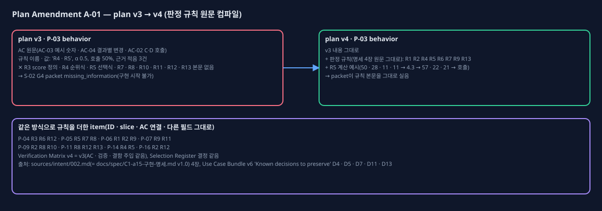

# Plan Amendment v4

## One-page change summary

- **무엇:** 명세 4장 판정 규칙 R1 ~ R13 본문(계산 예시 포함)을 원문 그대로, 그 규칙을 쓰는 plan item의 `compiled_product_contract.behavior` 끝에 '판정 규칙(명세 4장 원문 그대로 — L1 amendment A-01)' 절로 더했다.
- **item별 규칙:**

| Item | 넣은 규칙 |
| --- | --- |
| P-03 | R1 · R2 · R4 · R5 · R6 · R7 · R9 · R13 |
| P-04 | R3 · R6 · R12 |
| P-05 | R5 · R7 · R8 |
| P-06 | R1 · R2 · R9 |
| P-07 | R9 · R11 |
| P-09 | R2 · R8 · R10 |
| P-11 | R8 · R12 · R13 |
| P-14 | R4 · R5 |
| P-16 | R2 · R12 |

- **그대로인 것:** plan item 17개의 그 밖의 모든 필드 · slice · 경계 · AC 연결 · Selection 결정 · 실행 mode. Verification Matrix는 판 번호만 v4이고 AC · 검증 · 결함 주입은 v3와 같다.
- **왜:** S-02 G4에서 P-03 구현에 필요한 규칙 본문이 plan에 없어 멈췄다(`execution/S-02/g4-stop.md`). 규칙 이름 · 값 · AC 예시만으로는 식이 하나로 정해지지 않는다.

## Observed evidence

- 영향받는 plan item: P-03(직접) · P-04 · P-05 · P-06 · P-07 · P-09 · P-11 · P-14 · P-16(같은 규칙을 쓰는 item).
- 가정: "AC와 규칙 이름 · 값이면 판정 엔진을 구현할 수 있다" — 틀렸다.
- 제어: G4 expansion_rule(승인 전 문서 다시 읽기 금지) 때문에 G4에서 채울 수 없다.
- 증거: `execution/S-02/g4-stop.md`, plan v3 P-03 behavior(규칙 본문 없음), Use Case Bundle v6 packet 'Known decisions to preserve'(D4 · D5 · D7 · D11 · D13 이름만).

## Before and after

교체한 plan item: 없다(ID 그대로). behavior 문자열이 늘어난 item은 위 9개다.

## Alternatives considered

- **G1부터 다시:** Use Case Bundle v7에 규칙 본문을 넣고 G1 → G2 → G3 → PBC를 다시 거친다. 규칙에는 가장 맞지만 비용이 크다. 사용자가 고르지 않았다.
- **AC 예시로 식을 추정:** 예시 하나에 맞는 식이 여럿이라 추정 금지 규칙에 걸린다. 쓰지 않았다.
- **G5에서 명세를 직접 읽기:** G4 ~ G7 직접 입력 경계를 깨고, 같은 정보가 plan · 코드에 두 출처로 남는다. 쓰지 않았다.

## AC, slice, test, and authority impact

- AC: 바뀌지 않는다. AC-03 · 04 · 05 · 19 · 20 · 22 · 28 · 29 · 42 · 46 등은 그대로이고, 판정 근거가 원문 규칙으로 명확해질 뿐이다.
- slice: S-01은 완료(plan v3, 이번 수정과 무관 — P-01 · P-02에는 규칙을 넣지 않았다). S-02 ~ S-06 순서는 그대로다.
- test: Verification Matrix v4 = v3(AC · 결함 주입 같음). 규칙 원문의 계산 예시는 이미 AC-03 L1에 있다.
- 권한: 구현 승인 제안은 plan v4의 P-03 ~ P-07로 둔다. P-01 · P-02는 plan v3 승인으로 완료됐다. 실행 mode, 금지, 별도 승인 행동은 v3와 같다.

## Preservation statement

모든 승인 제품 약속이 그대로다. 옮긴 본문은 사용자가 승인한 구현 명세 v1.0(결정 D4 · D5 · D7 · D11 · D13, Use Case Bundle v6이 '지킬 결정'으로 가리킴)의 문장 그대로이고, 새 규칙 · 값을 만들지 않았다. 다만 두 가지는 원문을 그대로 두고 함께 밝힌다.

- **R3 토큰 규칙:** R3의 '토큰 = 공백 단위 + 한글 2-gram'과 Playbook EP-C1-FUSE-001(사용자 결정 '글자 2-gram')은 같은 방향이다. 다르게 읽힐 수 있는 부분은 원문대로 두고 P-04 구현에서 두 문장을 함께 만족시킨다(공백으로 나눈 단어 + 한글 2-gram).
- **R11 각본 경로:** R11의 '각본 파일 data/demo/scenarios.json [기본안 경로]'는 plan P-07 '각본 파일(10건, 행 번호)'과 같은 대상이다.

## Critic verdict and Human decision

(PBC-4 critic `critics/PBC4-4-review.json`과 Human Gate 뒤에 채운다.)
