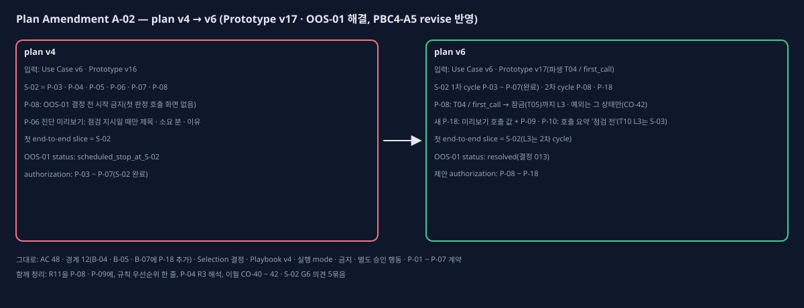

# Plan Amendment v6 (A-02, PBC4-A5 revise 반영)

## One-page change summary

- **무엇:** 승인 입력이 PBC-0 재잠금 v2로 바뀌어(Prototype Bundle v16 → v17, 파생 상태 T04 / first_call — 결정 013) 그 바뀐 범위만 plan에 반영했다.
  - **P-08**(정비자 앱 화면): T04 / first_call 화면 · 규칙 예외(그 상태에서만, CO-42) · E2E 경로를 더하고 AC-02를 연결했다. 'OOS-01 결정 전 시작 금지' 선행 조건을 지웠다.
  - **새 P-18**(진단 미리보기 보강, API): 첫 판정이 호출일 때도 서버가 확인 점검 이름 · 소요 분 · 근거 검사(R8)를 거친 이유를 낸다. S-02에서 만든 미리보기(P-06)는 점검 지시일 때만 이 값을 낸다. 화면은 API 값만 보이므로 서버 쪽 item이 필요하다.
  - **slice:** S-02는 1차 cycle(P-03 ~ P-07)만 끝났다(execution/S-02/cycle-decision.md). P-08 · P-18은 같은 slice S-02의 **2차 cycle**로 실행한다. 첫 end-to-end(FLOW-03 · SC-04)는 S-02 그대로이고 그 L3는 2차 cycle(완료 P-08)에서 판정한다. 첫 end-to-end slice가 경로의 모든 경계(B-01 ~ B-08)를 가진 item을 함께 담아야 하므로(S-02 1차 cycle의 B-04 ~ B-08 item과 2차 cycle의 B-01 · B-03 item) 새 slice로 나누지 않았다. S-03 이후 순서는 그대로.
  - **OOS-01:** status resolved(결정 013 → G3 v17 승인 → PBC-0 재잠금 v2).
  - **P-09 · P-10**(호출 요약 API · T10 화면, S-03): 첫 판정 호출에서 온 호출 요약(지금까지 점검 '점검 전', Prototype v17 흐름 원문 그대로)을 behavior · verifier에 넣었다(PBC4-A5 ISS-002).
  - **첫 판정 호출 경로의 L3 나눔**(PBC4-A5 ISS-001): S-02 2차 cycle(P-08)은 T04 / first_call → 잠금 → T05 / locked까지, 호출 요약 화면(T10 / summary '점검 전') 진입은 S-03의 P-10 L3에서 판정한다. T10 화면 · 호출 요약 API가 S-03 범위이기 때문이다.
- **함께 정리한 것(이전 결정):** R11을 P-08(알람 화면 추이) · P-09(재가동 표시 값)에 원문 그대로, 규칙 우선순위 한 줄(approved_gate_interpretations.rule_precedence), P-04의 R3 해석, 이월 CO-40 ~ 42. S-02 G6 비차단 의견 5묶음(S02-G6-1 ~ 5)은 carryover_resolution에 적고 **해당 item verifier에도 넣었다**: S02-G6-1 → P-09 · P-11, S02-G6-2 → P-08, S02-G6-3 → P-18(selected_approach · verifier), S02-G6-4 → P-09 · P-14 · P-18, S02-G6-5 → P-13.
- **그대로인 것:** AC 48개 · 경계 12개(B-04 · B-05 · B-07에 P-18이 더해짐) · Selection 결정(Selection Register v5 = v4 결정 그대로, 판 번호만) · Playbook v4 · 실행 mode per_slice_gated · 금지 · 별도 승인 행동 · P-01 ~ P-07 계약.

## Observed evidence

- 영향받는 plan item: P-08(직접) · 새 P-18 · P-09 · P-10(첫 판정 호출의 호출 요약) · P-03(OOS-01 문구만) · P-04(R3 해석 문구) · P-11 · P-13 · P-14(이월 시험 verifier).
- 가정: "P-06 진단 미리보기가 첫 판정 호출 화면 값을 이미 낸다" — 아니었다. 호출이면 kind · 절 · 등급 · 원인만 낸다(server/src/c1a15/api/sessions.py preview).
- 증거: `approved-inputs/changed-scope-v2.md`, `decisions/G3-prototype.json`(v17), `sources/intent/013.md`, `execution/S-02/oos01-first-judgment.md`, `execution/S-02/cycle-decision.md`(G6 이월 의견).

## Before and after

- 교체한 plan item: 없다.
- 더한 item: P-18(S-02 2차 cycle, 경계 B-04 · B-05 · B-07).
- 바뀐 item(v4 대비): P-08(acceptance_ids · requirement_signal · selected_approach · preconditions · trigger · verifier · stop · behavior · ui_state_interaction), P-09(behavior: 첫 판정 호출 호출 요약 · R11, verifier), P-10(behavior · verifier: 첫 판정 호출 T10), P-03 · P-04(behavior 문구만), P-11 · P-13 · P-14(verifier: S-02 G6 이월만).
- 완료된 P-01 · P-02 · P-05 · P-06 · P-07은 v4와 같다.

## Alternatives considered

- **P-06을 다시 여는 수정(같은 ID):** 완료 기록(S-02)과 새 변경이 한 item에 섞여 추적이 흐려진다. 쓰지 않았다.
- **P-08 안에서 API까지:** P-08 경계는 B-01 · B-03(화면)이라 권한 경계가 섞인다. 쓰지 않았다.
- **화면이 이유 문장을 만듦:** 승인 권한 경계('화면은 API가 준 값만')와 R8 근거 검사를 어긴다. 쓰지 않았다.

## AC, slice, test, and authority impact

- AC: 바뀌지 않는다. AC-02 연결에 P-08 · P-18이 더해졌다(완료 item은 그대로 P-16 — 평가 등급 위반 0).
- slice: S-01 완료, S-02 1차 cycle 완료. 다음은 S-02 2차 cycle(P-08 · P-18) → S-03 ~ S-06.
- test: Verification Matrix v6 — AC-02에 L2(P-18 미리보기 호출 값 · 대체 · 절차 없음), L3(P-08: T04 / first_call → 잠금 → T05 / locked, 예외 번짐 없음), L2(P-09: 첫 판정 호출의 호출 요약 응답 '점검 전'), L3(P-10: → T10 / summary '점검 전') 추가, 첫 end-to-end 표기를 S-02 2차 cycle로, 수동 검토의 OOS-01 줄을 해결 기록으로, CO-40 대조 값 추가. 결함 주입 9개 그대로.
- 권한: 구현 승인 제안 P-08 ~ P-18, per_slice_gated(slice마다 사람 결정). 금지 · 별도 승인 행동은 v4와 같고 openapi-typescript 설치(P-08)는 별도 승인.

## Preservation statement

모든 승인 제품 약속이 그대로다. T04 / first_call의 화면 · 예외는 G3 v17 승인 범위 그대로 옮겼고, 새 화면 · 흐름 · 권한 · 데이터 의미를 만들지 않았다. P-18은 승인 화면이 이미 요구하는 값을 서버가 내도록 하는 것이며 판정 규칙(R2 · R5 · R8)은 원문 그대로다.

## PBC4-A5 revise와 이번 수정

- `critics/PBC4-5-review.json`(revise): ISS-001(P-08 L3가 S-03 범위 T10 · P-09에 기댐) · ISS-002(첫 판정 호출의 호출 요약 '점검 전'이 어느 item에도 없음), 비차단 3건.
- 사용자 결정: `coding-plan/v5/decisions/pbc4-a5-user-decisions.md`('plan v6로 고침').
- 고친 것: 위 'One-page change summary'의 P-09 · P-10 · L3 나눔, S-02 G6 이월의 verifier 반영, 더한 item · 바뀐 item 구분, P-08 verifier에 '원문으로 대체됨' 카드 구조 확인. 덧붙여 v5 Selection Register 파일의 version 값이 'v4'로 남아 있던 생성기 오류를 v6에서 바로잡았다(내용 같음).

## Critic verdict and Human decision

(PBC4-A6 critic과 Human Gate 뒤에 채운다.)
