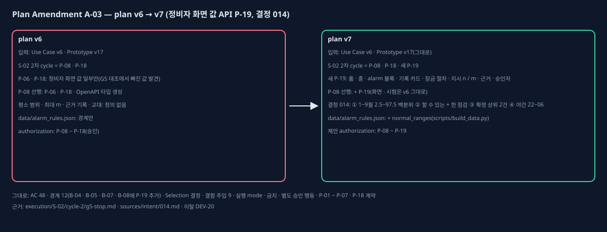

# Plan Amendment A-03 (plan v6 → v7, 정비자 화면 값 API)

## One-page change summary

- **무엇:** S-02 2차 cycle G5에서 P-08(정비자 앱 화면)을 시작하기 전에 Prototype v17의 정비자 화면 template을 지금 API 응답과 대조했다. 화면이 보여야 하는데 API가 주지 않는 값이 나왔다(`execution/S-02/cycle-2/g5-stop.md`). 승인 권한 경계('화면은 API가 준 값만 보인다') 때문에 앱이 그 값을 만들 수 없다. 이 값을 더하면 공개 API 응답이 바뀌므로 L1이다.
  - **새 P-19**(정비자 화면 값 API 보강, S-02 2차 cycle, 경계 B-04 · B-05 · B-07 · B-08): 기존 응답에 화면 값을 더한다. 새 엔드포인트는 없고 OpenAPI 정본을 갱신한다. 더하는 값: 홈 교대 현황 · 알람 행 진행(점검 n / 최대 m) · 최근 내 보고서(S-03 전에는 빈 목록), 종 목록 진행, 세션 응답 alarm 블록(설비 종류 · 계통 · 센서 표 5행 · 평소 범위 · 상태 · 이탈 수 · 추이 · AI 해석(R8) · 찾은 기록 수), 과거 기록 카드 3장 값, 잠금 전 1.2절 절차, 지시의 점검 n / 최대 m · 근거 기록 번호, 과거 기록 승인자 · 출처. 데이터에서는 `data/alarm_rules.json`에 normal_ranges를 더한다(scripts/build_data.py).
  - **P-08:** 선행 조건에 P-19만 더했다. 화면 · 행동 · 시험은 v6와 같다.
  - **화면 값 정의(결정 014, `sources/intent/014.md`):** 승인 묶음과 구현 명세에 정의가 없는 네 가지를 사용자에게 물어 정했다. ① 평소 범위 = 1~9월 2.5~97.5 백분위, ② 최대 m = 지금 혼자 할 수 있는 점검 + 이미 한 점검, ③ 근거 기록 = 그 점검 원인으로 확정된 상위 기록 최대 2건, ④ 오늘 교대 = 야간 22:00~06:00 고정, 내 기록 기준. 그 밖의 값(설비 종류 · 계통 · 승인자 · 유사 % · 잠금 절차)은 데이터나 규칙 원문(R1 · R3)에 이미 있다. PBC가 데이터 의미를 정한 것이라 이탈 DEV-20으로 적었다.
- **그대로인 것:** AC 48개 · 경계 12개(B-04 · B-05 · B-07 · B-08에 P-19가 더해짐) · Selection 결정(Selection Register v7 = v6 결정 그대로, P-19가 쓰는 record의 plan_item_ids만) · 결함 주입 9건 · 실행 mode per_slice_gated · 금지 · 별도 승인 행동 · P-01 ~ P-07 · P-18 계약. P-18 코드와 이미 승인받아 설치한 패키지 네 묶음도 그대로다.

## Observed evidence

- 영향받는 plan item: 새 P-19, P-08(선행 조건만).
- 가정: "P-06(API 핵심)과 P-18이 정비자 화면 값을 다 낸다" — 아니었다. 화면별로 빠진 값은 `execution/S-02/cycle-2/g5-stop.md`의 표에 있다.
- 증거: `execution/S-02/cycle-2/g5-stop.md`, `sources/intent/014.md`, `decisions/PBC-4-prebuild-contract.json`(v6 승인), Prototype v17 정비자 화면 template(T02 ~ T06 · T12 · T13).

## Before and after

- 교체한 plan item: 없다.
- 더한 item: P-19(S-02 2차 cycle).
- 바뀐 item(v6 대비): P-08(preconditions만).
- 완료된 P-01 ~ P-07과 구현한 P-18은 v6와 같다.

## Alternatives considered

- **이 cycle에서 L0로 채움:** 공개 API 응답이 바뀌므로 L0 범위(실행 카드의 허용 서버 변경 = 미리보기 · 결과 입력 검증)를 넘는다. 사용자가 고르지 않았다.
- **앱이 값을 만듦(예: 평소 범위 상수, 교대 계산):** 권한 경계 '화면은 API가 준 값만'을 어기고, AI 해석은 R8 근거 검사를 거치지 않게 된다. 쓰지 않았다.
- **P-06 · P-18을 다시 여는 수정(같은 ID):** 완료 · 구현 기록과 새 변경이 섞인다. 쓰지 않았다.
- **여기서 멈춤:** 사용자가 고르지 않았다.

## AC, slice, test, and authority impact

- AC: 바뀌지 않는다. AC-01 · 06 · 13 · 31 · 37 · 38 · 40에 P-19가 연결됐다.
- slice: S-02 2차 cycle = P-08 · P-18 · P-19. S-03 이후 순서는 그대로다.
- test: Verification Matrix v7은 위 AC에 P-19 L2(API 통합 시험)를 더했다. 결함 주입 9건은 그대로다.
- 권한: 구현 승인 제안은 P-08 ~ P-19, per_slice_gated. 금지 · 별도 승인 행동은 v6와 같다.

## Preservation statement

승인된 제품 약속은 모두 그대로다. P-19는 승인 화면(Prototype v17)이 이미 보이는 값을 서버가 내게 할 뿐이고, 새 화면 · 흐름 · 권한을 만들지 않는다. 판정 규칙(R1 · R3 · R8 · R11)은 원문 그대로다. 정의가 없던 값 네 가지는 사용자 결정 014를 그대로 옮겼다.

## Critic verdict and Human decision

(PBC4-A7 critic과 Human Gate 뒤에 채운다.)
