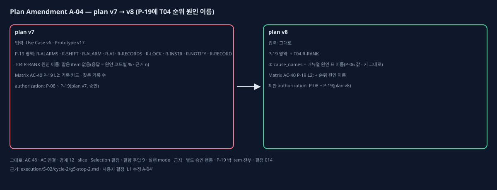

# Plan Amendment A-04 (plan v7 → v8, 순위 원인 이름)

## One-page change summary

- **무엇:** P-19 구현 전에 정비자 화면 template 24개를 v7 계약과 다시 대조했다(`execution/S-02/cycle-2/g5-stop-2.md`). 진단 화면 T04의 원인 후보 순위(R-RANK)에 원인 이름이 보여야 하는데, 세션 응답은 원인 코드별 % · 근거 n만 준다. 이 영역의 서버 값을 맡은 item이 없었다. 응답에 필드를 더하는 일이라 L1이다.
  - **P-19:** prototype_refs에 T04 / default / R-RANK를 더했다. ui_state_interaction에 그 영역 계약(P-08의 같은 문장 그대로)을 더하고, selected_approach에 ⑨ cause_names를 더했다. cause_names는 순위 · 근거 n의 원인 코드마다 매뉴얼 원인 표(x.1 개요 '원인 후보')의 이름이다. verifier에는 원인 이름 = 원인 표 이름(표 기반 unit)을 더했다. P-06의 probabilities · evidence 값과 키는 그대로다.
  - **Verification Matrix v8:** AC-40의 P-19 L2 기대 증거에 '순위 원인 이름 = 매뉴얼 원인 표 이름'을 더했다.
- **그대로인 것:** AC 48개 · AC 연결 · 경계 12개 · slice · Selection 결정(Selection Register v8 = v7, 판 번호만) · 결함 주입 9건 · 실행 mode · 금지 · 별도 승인 행동. P-19 밖의 item은 모두 v7과 같고, 화면 값 정의(결정 014)도 그대로다.

## Observed evidence

- 영향받는 plan item: P-19(prototype_refs · compiled_product_contract.ui_state_interaction · requirement_signal · selected_approach · verifier).
- 가정: "P-06 세션 응답의 순위 값으로 T04 순위 영역을 그릴 수 있다". 그렇지 않았다. 원인 이름이 없다.
- 증거: `execution/S-02/cycle-2/g5-stop-2.md`, Prototype v17 T04 template(default · first_call · low_evidence의 R-RANK 행 = 순번 · 원인 이름 · 막대 · % · 근거 n).

## Before and after

- 교체한 plan item: 없다.
- 더한 item: 없다.
- 바뀐 item(v7 대비): P-19만.

## Alternatives considered

- **P-19 실행 해석으로 넣기(이탈 DEV-21):** 공개 API 응답 변경 = L1 규칙에서 벗어난다. 사용자가 고르지 않았다.
- **앱이 원인 코드를 이름으로 바꿈:** 권한 경계 '화면은 API가 준 값만'을 어긴다. 쓰지 않았다.
- **P-06을 다시 여는 수정:** 완료 기록과 섞인다. 쓰지 않았다.

## AC, slice, test, and authority impact

- AC: 바뀌지 않는다(P-19는 이미 AC-40 연결).
- slice: 그대로 — S-02 2차 cycle = P-08 · P-18 · P-19.
- test: Matrix v8 AC-40 L2 문구 하나.
- 권한: 구현 승인 제안 P-08 ~ P-19(plan v8), per_slice_gated. 금지 · 별도 승인 행동은 v7과 같다.

## Preservation statement

승인된 제품 약속은 모두 그대로다. 원인 이름은 승인 화면(Prototype v17 T04 R-RANK)이 이미 보이는 값이다. 값은 매뉴얼 원인 표에 이미 있는 이름이고, 새 의미 · 흐름 · 권한이 없다.

## Critic verdict and Human decision

(PBC4-A9 critic과 Human Gate 뒤에 채운다.)
