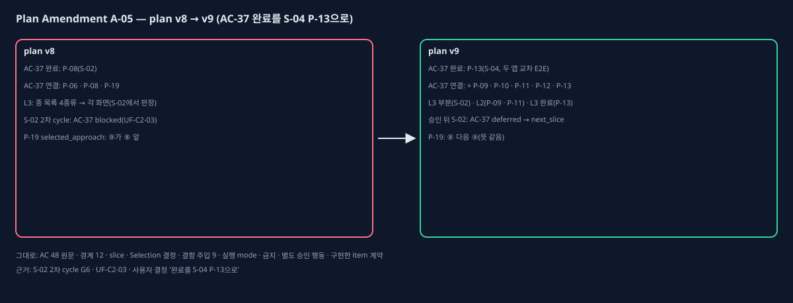

# Plan Amendment A-05 (plan v8 → v9, AC-37 완료 slice)

## One-page change summary

- **무엇:** AC-37(정비자 앱 종 목록에 알람 · 할 일 4종류가 보이고 항목에서 해당 화면으로 감)의 완료 item이 P-08(S-02)이었다. 그런데 관찰 조건 가운데 '파트장 답이 온 호출' · '반려된 보고서'는 그 기록이 S-03(호출, P-09 · P-10) · S-04(파트장 답 · 반려, P-11 · P-12) 전에는 생기지 않는다. S-02 2차 cycle G6에서 AC-37은 blocked였다(`execution/S-02/cycle-2/verification-report.json`, ledger UF-C2-03). 검증 계획의 완료 item이 바뀌므로 L1이다.
  - **Verification Matrix v9 · AC-37:**
    - plan_item_ids는 P-06 · P-08 · P-19에 P-09 · P-10 · P-11 · P-12 · P-13을 더한다. completion_plan_item_id는 P-13이다.
    - L3(S-02 부분)은 배정 새 알람 · 진행 중 점검 · 빈 목록이다. 이번 cycle 증거가 그대로 부분 증거가 된다.
    - L2(P-09 · P-11)는 종 목록 API의 호출 답 · 반려 보고서 항목이다.
    - L3(P-13, 완료)는 교차 E2E에서 4종류와 각 항목의 이동이다.
  - **Coding Plan v9:** P-09 · P-10 · P-11 · P-12 · P-13의 acceptance_ids에 AC-37을 더했다. compiled_product_contract.behavior에는 AC-37 원문(P-08과 같은 줄)을 더했다. verifier에는 각 item의 AC-37 몫을 한 문장씩 더했다.
  - **함께 정리:** P-19 selected_approach의 ⑨ · ⑧ 순서를 바로잡았다(뜻 같음, PBC-4 v9 실행 해석 ①).
- **그대로인 것:** AC 48개의 원문 · 관찰 조건, 경계 12개, slice, Selection 결정(Register v9 = v8, 판 번호만), 결함 주입 9건, 실행 mode, 금지 · 별도 승인 행동. 완료 · 구현한 P-01 ~ P-08 · P-18 · P-19의 계약도 바뀌지 않는다(P-19는 문장 순서만).

## Observed evidence

- 영향받는 plan item: P-09 · P-10 · P-11 · P-12 · P-13(AC-37 연결), P-19(순서만).
- 가정: "종 목록 화면을 만드는 slice에서 네 종류를 모두 판정할 수 있다". 그렇지 않았다.
- 증거: `execution/S-02/cycle-2/verification-report.json`(AC-37 blocked), `execution/S-02/cycle-2/execution-ledger.json`(UF-C2-03), `execution/S-02/cycle-2/cycle-decision.md`(amendment), `execution/S-02/cycle-2/g6-revise-decision.md`(사용자 결정).

## Before and after

- 교체한 plan item: 없다. 더한 item: 없다.
- 바뀐 item(v8 대비): P-09 · P-10 · P-11 · P-12 · P-13(acceptance_ids · compiled_product_contract.behavior · verifier), P-19(selected_approach 순서).

## Alternatives considered

- **완료를 S-03 P-10으로:** 반려 보고서가 S-04에서야 생겨 그 부분은 다시 미뤄야 한다. 사용자가 고르지 않았다.
- **S-02에서 시험용 기록을 넣어 판정:** 그 기록을 만드는 item(P-09 · P-11)이 없어 실제 경로가 아니다. 쓰지 않았다.

## AC, slice, test, and authority impact

- AC: 원문 · 관찰 조건은 그대로다. AC-37 연결 item과 완료 item만 바뀐다.
- slice: 그대로다. 다음은 S-03이고, S-02 2차 cycle은 승인 뒤 AC-37을 deferred로 고쳐 닫는다.
- test: Matrix v9 AC-37에 L2 한 줄 · L3 한 줄을 더하고, S-02 L3 줄은 '부분'으로 표시했다.
- 권한: 구현 승인 제안은 plan v9 P-08 ~ P-19, per_slice_gated. 금지 · 별도 승인 행동은 v8과 같다.

## Preservation statement

승인된 제품 약속은 모두 그대로다. 종 목록 4종류 · 이동 · 빈 목록은 승인 화면(Prototype v17 T12)과 AC-37 원문 그대로다. 바뀌는 것은 그 판정을 언제 · 어느 item으로 하느냐뿐이다.

## Critic verdict and Human decision

(PBC4-A10 critic과 Human Gate 뒤에 채운다.)
