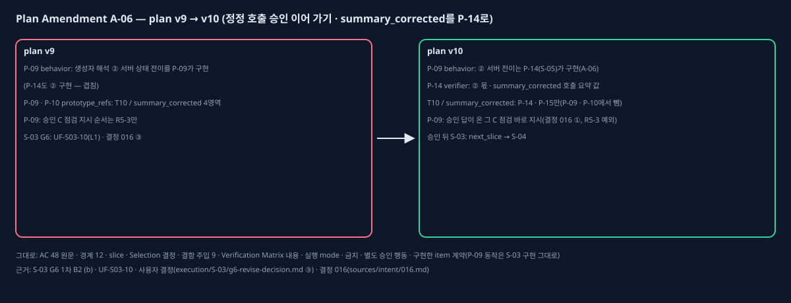

# Plan Amendment A-06 (plan v9 → v10, 정정 호출 승인 이어 가기 · summary_corrected 정리)

## One-page change summary

- **무엇:** P-09(S-03) compiled_product_contract.behavior가 생성자 해석 ②(사용자 결정 012 — 조치 뒤 정정 호출의 '승인 후 진행'은 새 작업을 열지 않고 정비자가 정정 때 하던 단계로 '이어서 하기')를 "서버 상태 전이로 구현한다"고 적었다. 이 전이는 정정 기록(정정 덧붙임)에 기대는데, 그 기록은 P-14(S-05)가 만들고 P-14도 같은 ②를 구현한다고 적혀 있다(겹침). S-03 G6 1차 검토(B2 (b))가 이를 잡았고, 사용자가 'S-05로 넘김(L1)'을 골랐다(`execution/S-03/history/g6-revise-decision-v2.md` ③, ledger UF-S03-10). 계약 문장을 맡는 item이 바뀌므로 L1이다.
  - **Coding Plan v10 · P-09:** behavior의 ② 문장을 "② 서버 상태 전이는 정정 기록을 만드는 P-14(S-05)가 구현(A-06)"으로 바꾸고, 같은 자리에 사용자 결정 016 ①(파트장 '승인 후 진행' 답이 온 그 C 점검은 바로 다음 지시, 한 번 하면 다시 R5-3 — 명세 S4-4 · AC-08-C2 · T10 / ans_approved, R5-3 예외)을 적었다(S-03 G6 비차단 의견).
  - **P-09 · P-10 prototype_refs · ui_state_interaction:** T10 / summary_corrected 4영역(R-TOP · R-STEP · R-CALLHEAD · R-CALLACT)을 뺐다. 이 상태는 P-14 · P-15가 이미 가진다(사용자 결정 016 ③ — S-03 구조 대조에서 이 4영역은 slice 밖).
  - **P-14 verifier:** ② 몫(서버 상태 전이 시험)과 T10 / summary_corrected 호출 요약 값 한 문장을 더했다.
- **그대로인 것:** AC 48개 원문 · 관찰 조건, Verification Matrix 내용(v10 = v9, 판 번호만 — AC-47 L3가 이미 P-14 · P-15에서 T10 / summary_corrected를 본다), 경계 12개, slice, Selection 결정(Register v10 = v9), 결함 주입 9건, 실행 mode, 금지 · 별도 승인 행동. 완료 · 구현한 P-01 ~ P-10 · P-18 · P-19의 동작도 바뀌지 않는다(P-09 · P-10은 S-03에서 구현한 그대로이고, 계약 문장이 실제 구현 범위와 맞춰진다).

## Observed evidence

- 영향받는 plan item: P-09(behavior 한 문장 · prototype_refs · ui_state_interaction), P-10(prototype_refs · ui_state_interaction), P-14(verifier 한 문장).
- 가정: "P-09가 호출 · 답 상태 전이를 만들 때 정정 호출의 답 처리도 함께 만들 수 있다". 정정 기록이 없어 그렇지 않았다.
- 증거: `critics/G6-S03-review.json`(B2 (b)), `execution/S-03/history/execution-ledger-v3.json`(UF-S03-03 · UF-S03-10), `execution/S-03/history/cycle-decision-v1.md`(amendment), `execution/S-03/history/g6-revise-decision-v2.md`(사용자 결정), `sources/intent/016.md`(결정 016 ① · ③), 학습 기록 `learning-record.md`(LR-06).

## Before and after

- 교체한 plan item: 없다. 더한 item: 없다.
- 바뀐 item(v9 대비): P-09(compiled_product_contract.behavior · ui_state_interaction, prototype_refs), P-10(compiled_product_contract.ui_state_interaction, prototype_refs), P-14(verifier).

## Alternatives considered

- **S-03에서 정정 기록 형식까지 정함:** P-14의 정정 입력 · 기록 범위를 S-03이 앞당긴다. 사용자가 고르지 않았다(결정 016 ③ · g6-revise-decision ③).
- **P-09 문장을 그대로 두고 S-04 · S-05에서 처리:** 계약과 구현 범위가 어긋난 채 S-03을 닫게 된다. 쓰지 않았다.

## AC, slice, test, and authority impact

- AC: 원문 · 관찰 조건 · 연결 item · 완료 item 모두 그대로다(AC-47 완료 P-15, 정정 AC는 P-14 · P-15).
- slice: 그대로다. 승인 뒤 S-03은 next_slice로 닫고 S-04로 간다.
- test: Matrix 내용 그대로. P-14 verifier에 ② 상태 전이 시험 한 문장.
- 권한: 구현 승인 제안은 plan v10의 P-08 ~ P-19, per_slice_gated. 금지 · 별도 승인 행동은 v9와 같다.

## Preservation statement

승인된 제품 약속(결정 012 ② 정정 호출 '이어서 하기', T10 / summary_corrected 화면, T10 / ans_approved '그 C 지시가 열림')은 모두 그대로다. 바뀌는 것은 어느 item이 언제 구현 · 판정하느냐와, 승인 C 바로 지시가 R5-3 점수 순서의 예외라는 점을 계약에 적는 것뿐이다.

## Critic verdict and Human decision

(PBC4-A11 critic과 Human Gate 뒤에 채운다.)
