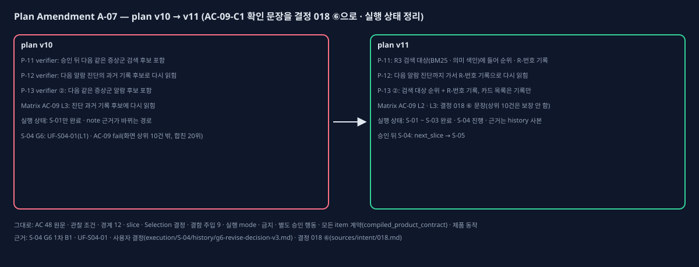

# Plan Amendment A-07 (plan v10 → v11, AC-09-C1 확인 문장 · 실행 상태 정리)

## One-page change summary

**무엇이 문제였나:** AC-09-C1은 '승인 뒤 같은 증상군 알람의 검색 후보에 그 보고서(출처 승인 보고서)가 포함된다'이다. 그런데 Verification Matrix v10 AC-09 L3와 P-12 · P-13 verifier는 이를 '다음 같은 증상군 알람의 정비자 진단 과거 기록 후보(진단 화면 상위 10건)에 다시 읽힘'으로 확인하게 적었다.

S-04에서 확인한 사실은 다음과 같다.
- 승인 보고서는 다음 같은 증상군 알람의 R3 검색 대상(BM25 · 의미 색인)에 들어 순위가 매겨진다. 승인 전에는 어느 순위에도 없고, 승인 뒤 BM25 3위 · 합친 20위다(fixture 가짜 임베딩, 시험 질의).
- 그러나 진단 화면 상위 10건에는 들지 않는다.
- 정비자 기록 창은 그 카드와 지시 근거 번호로만 열리므로, 화면으로는 열 수 없다. 같은 API로는 R-번호 기록이 열린다.

G5 중 사용자 결정 018 ⑥('검색 대상에 들어 순위가 매겨짐')으로 판정했지만 이 해석이 packet에 없었다. 그래서 G6 1차(B1)가 L1로 분류했고(UF-S04-01), 사용자가 'L1로 고치고 G7 amendment' · '검증 문구만 고침'을 골랐다(`execution/S-04/history/g6-revise-decision-v3.md`).

**바뀌는 것(Coding Plan v11):**
- **P-11 verifier:** '승인 뒤 다음 같은 증상군 검색 후보 포함' → 'R3 검색 대상(BM25 · 의미 색인)에 들어 순위가 매겨짐(승인 전에는 없음) · 출처 승인 보고서 R-번호 기록이 열림(상위 10건 포함은 보장하지 않음)'
- **P-12 verifier:** '다음 알람 진단의 과거 기록 후보로 다시 읽힘' → '다음 같은 증상군 알람 진단까지 가서 R-번호 기록으로 다시 읽힘, 진단 카드 목록은 기록만'
- **P-13 verifier ②:** '다음 같은 증상군 알람 후보 포함' → '검색 대상에 들어 순위가 매겨지고 그 알람 진단까지 가서 R-번호 기록이 열림, 카드(상위 10건) 포함은 보장하지 않고 카드 목록만 기록'
- **execution_status(이전 승인에서 '다음 plan 판에서'로 미룬 정리 — PBC4-A10 실행 해석 ② · PBC4-A11 실행 해석 ③, 사용자 'A-07에 함께 정리'):**
  - 구조 필드를 completed_slices(S-01 · S-02 · S-02-cycle-2 · S-03) · in_progress_slices(S-04) · remaining_slices(S-05 · S-06)로 정리했다.
  - note의 A-05 · A-06 근거를 바뀌지 않는 history 사본 경로로 바꿨다. S-02 2차 cycle 결정 문서 사본 `execution/S-02/cycle-2/history/g6-revise-decision-v1.md`는 이번에 만들었다.

**바뀌는 것(Verification Matrix v11):** AC-09 L2 · L3 expected_evidence만 사용자 결정 018 ⑥ 문장으로 맞췄다.
- L2: 승인 전 없음 → 승인 뒤 BM25 · 의미 색인 · 합친 순위에 들어감, 메모리 색인은 commit 뒤
- L3: 다음 알람 진단까지 가서 R-번호 기록으로 다시 읽힘, 카드 목록은 기록만

**그대로인 것:**
- AC 48개 원문 · 관찰 조건(AC-09-C1 문장 포함), 모든 item의 compiled_product_contract · 범위 · 경계 · slice
- Selection 결정(Register v11 = v10), 결함 주입 9건, 실행 mode, 금지 · 별도 승인 행동
- 구현한 P-01 ~ P-13 · P-18 · P-19의 동작

**확인만 한 것:** P-19 selected_approach의 큰 번호(① ~ ⑨)는 v10에서 이미 순서대로다. 안쪽의 '결정 014 ④' 같은 인용 번호가 섞여 보였을 뿐이라 바꾸지 않는다(PBC4-A9 실행 해석 ①). LR-06의 판 범위 정정은 `learning-record.md`(LR-07)의 정정 절에 둔다(LR-06 파일은 consistency check hash로 잠김).

## Observed evidence

- 영향받는 plan item: P-11 · P-12 · P-13(verifier 문장).
- 가정: '승인 보고서는 다음 같은 증상군 알람의 진단 과거 기록 후보(상위 10건)에 들어간다'. 질의 · 데이터 · 임베딩에 달려 있어 보장되지 않았다.
- 증거:
  - `critics/G6-S04-review.json`(B1), `critics/G6-S04-2-review.json` · `critics/G6-S04-3-review.json`(pass)
  - `execution/S-04/history/execution-ledger-v3.json`(UF-S04-01), `execution/S-04/history/verification-report-v3.json`(AC-09 fail), `execution/S-04/history/cycle-decision-v1.md`(amendment)
  - `execution/S-04/history/g6-revise-decision-v3.md`(사용자 결정), `sources/intent/018.md`(⑥)
  - `execution/S-04/evidence/ac09-r3-positions.txt`(순위 값)
  - 학습 기록 `learning-record.md`(LR-07)

## Before and after

- 교체한 plan item: 없다. 더한 item: 없다.
- 바뀐 item(v10 대비): P-11 · P-12 · P-13(verifier만).
- 바뀐 최상위 필드: execution_status.

## Alternatives considered

- **검색 규칙(R3)을 바꿔 승인 보고서가 상위 10건에 들게 함:** 승인된 검색 · 순위 계약을 바꾸는 일이다. 사용자가 고르지 않았다.
- **AC-09-C1 원문을 고침:** 승인 Use Case의 AC를 바꾸는 범위 밖 계약 변경이다. 쓰지 않았다.

## AC, slice, test, and authority impact

- **AC:** 원문 · 관찰 조건 · 연결 item · 완료 item(P-13) 모두 그대로다. AC-09-C1의 '검색 후보'를 R3 검색 대상(순위가 매겨짐)으로 확인한다는 점을 Matrix와 verifier에 적는다.
- **slice:** 그대로다. 승인 뒤 S-04는 next_slice로 닫고, S-05 G4는 지시 때 한다.
- **test:** S-04에서 이미 이 문장대로 시험했다.
  - L2: test_lead_overview_rows_and_approve_adds_history의 r3_positions(승인 전 · 뒤 대조)
  - L3: 교차 E2E 첫 시험(다음 알람 진단 · 카드 목록 기록 · R-번호 기록 API)
  - 승인 뒤 다시 돌리지 않아도 판정이 그대로다(report v3 AC-09는 이 문장 기준이면 pass).
- **권한:** 구현 승인 제안은 plan v11의 P-08 ~ P-19, per_slice_gated. 금지 · 별도 승인 행동은 v10과 같다.

## Preservation statement

승인된 제품 약속(승인 보고서가 이력 · 색인에 들어가 다음 같은 증상군 알람의 검색 대상이 됨, 평가 모드 제외, 출처 승인 보고서)은 그대로다. 바뀌는 것은 그 약속을 무엇으로 확인하느냐뿐이다. 진단 화면 상위 10건 포함은 질의 · 데이터에 달린 결과라 확인 문장에서 뺀다.

## Critic verdict and Human decision

(PBC4-A12 critic과 Human Gate 뒤에 채운다.)
