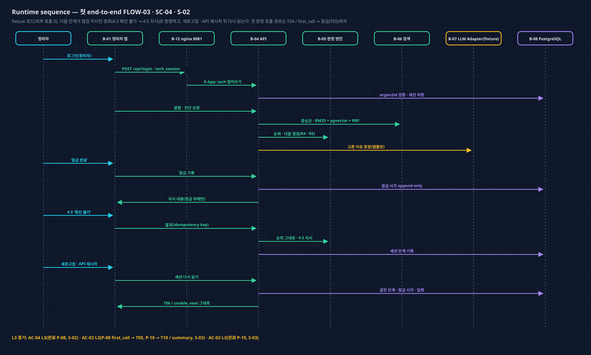
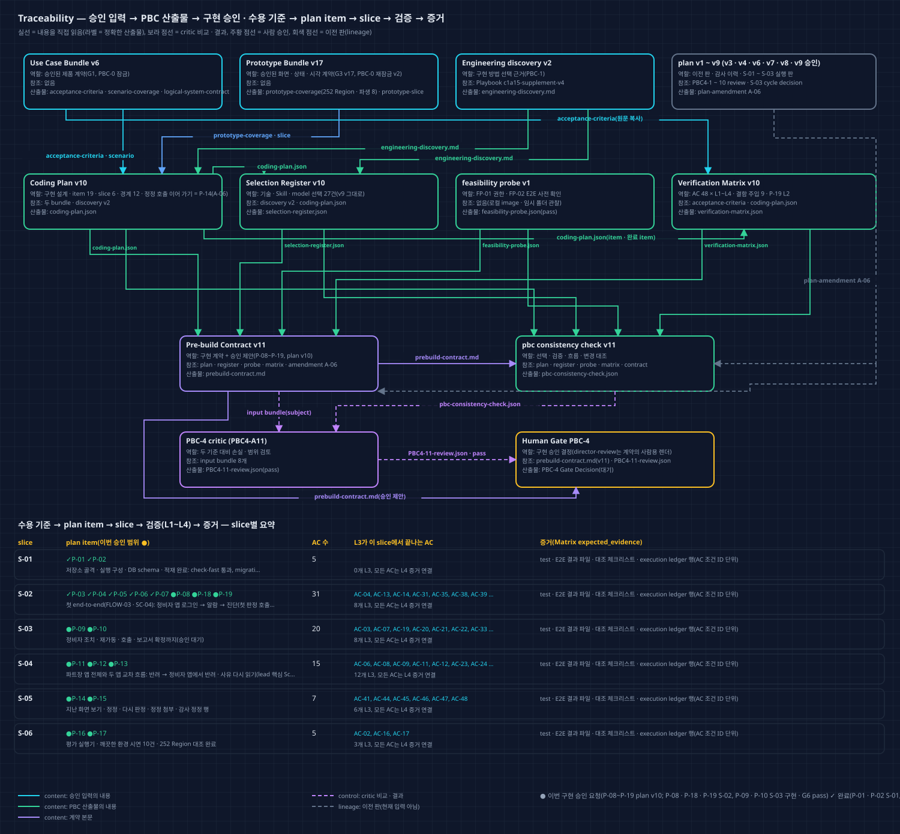
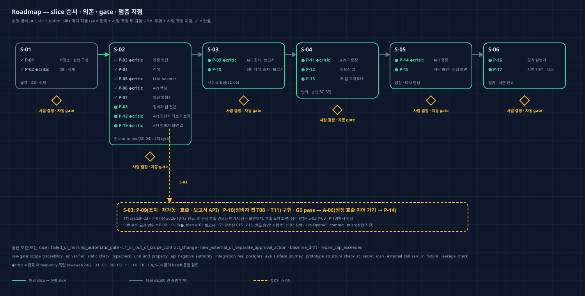

# Coding Plan v10 — Director Review

Run `2026-10-11-c1a15-product-r2` · PBC-4 · approval attempt `PBC4-A11`(L1 plan amendment A-06, 부모 PBC4-A10 pass · 승인, plan v9) · 독립 검토 pass(`critics/PBC4-11-review.json`) · 계약 `prebuild/v11/prebuild-contract.md` · 2026-10-13. 이 문서와 그림 4장은 critic pass 뒤 같은 plan v10에서 한 번 렌더했다. 승인된 v9와 달라진 점: `coding-plan/amendments/A-06/plan-amendment.md`, 계기: S-03 G7 amendment(`execution/S-03/history/cycle-decision-v1.md`).

## 한눈에 보기

- **왜 다시 계획했나:** S-03 G6 검토에서 P-09 계약이 '조치 뒤 정정 호출에 승인 답이 오면 정정 때 하던 단계로 이어 가기'를 맡는다고 적었는데, 이 전이는 정정 기록(S-05 P-14가 만듦)이 있어야 만들 수 있다. P-14도 이미 같은 일을 맡고 있었다(plan v1부터 겹침).
- **바뀐 것(v9 대비):** P-09의 그 문장을 'P-14가 구현'으로 바꿨다. T10 / summary_corrected 4영역은 P-09 · P-10에서 뺐다(P-14 · P-15에 그대로 있음 — 252 Region 그대로). P-09에 결정 016 ①(승인 답이 온 그 C 점검 바로 지시, R5-3 예외)을 적었다. P-14 verifier에 그 몫 한 문장을 더했다.
- **그대로인 것:** AC 원문 · Verification Matrix 내용, 경계, slice, 기술 선택, 결함 주입, 실행 방식, 금지 · 별도 승인 행동, 구현한 item의 동작(P-03 계약도 바꾸지 않음 — 결정 016 ①은 P-09의 호출 답 처리에 적었다).
- **이번 승인 범위:** **P-08 ~ P-19**(plan v10), `per_slice_gated`. 승인 뒤 S-03 cycle decision을 next_slice로 다시 써 S-03을 닫고 S-04로 간다.
- **검토 이력:** … A10 pass(v9, 승인), **A11 pass(v10)**.

## 사용자 기대와 계획의 대응

| 사용자가 이 단계에서 기대한 것 | 계획 artifact / ID | 확인 방법 |
| --- | --- | --- |
| 승인 답이 온 그 C 점검이 바로 열린다(결정 016 ①) | P-09 behavior(R5-3 예외 명시) | S-03 test_s03_approved_c_opens_and_d_never · E2E AC-03 L3 |
| 정정 호출 승인 뒤 이어 가기 · 정정 호출 요약 화면은 정정 기록과 함께 S-05에서(결정 016 ③ · G6 결정 ③) | P-14 verifier · P-14 · P-15 prototype_refs | consistency check change_representation, S-05 G6 |
| 반려 뒤 재개 · 다시 확정은 S-03에서(G6 결정 ②) | P-09(구현됨) | S-03 test_s03_rejected_report_resume_and_reconfirm |
| 구현한 item 동작 · P-03 계약은 그대로 | P-01 ~ P-10 · P-18 · P-19 | v9 대비 JSON diff(바뀐 item 3개) |

## What remains fixed

승인 Use Case Bundle v6 · Prototype Bundle v17(`approved-inputs/approved-artifact-manifest.json` v2)의 AC · 흐름 · 권한 · 데이터 의미 · 화면 구조 · Component foundation · 표시 조정 · 생성자 해석 · T04 / first_call 규칙 예외(그 상태에서만)가 고정된다. 기준선은 `discovery/planning-baseline.json` v3(HEAD f73c240, S-01 · S-02 산출물은 commit 전)이다.

## What this plan will and will not do

- **한다:** 아래 plan item. ✓는 완료, ●는 이번 승인 요청이다.
- **하지 않는다:** 배포 · 외부 메시지 · 실제 설비 연동 · Non-goals. 앱이 화면 값을 직접 만들지 않는다. 완료 item 계약을 바꾸지 않는다. live OpenAI는 승인 전에 쓰지 않는다. 다른 저장소 · Wiki를 고치지 않는다.

| Item | 내용 | Slice | 상태 | 검토 | AC |
| --- | --- | --- | --- | --- | --- |
| P-01 | 저장소 · 실행 구성 | S-01 | ✓ 완료 | automatic | 2 |
| P-02 | DB · 적재 | S-01 | ✓ 완료 | independent_critic | 4 |
| P-03 | 판정 엔진 | S-02 | ✓ 완료 | independent_critic | 16 |
| P-04 | 검색 | S-02 | ✓ 완료 | automatic | 3 |
| P-05 | LLM Adapter | S-02 | ✓ 완료 | independent_critic | 3 |
| P-06 | API 핵심 | S-02 | ✓ 완료 | independent_critic | 10 |
| P-07 | 알람 발생기 | S-02 | ✓ 완료 | automatic | 3 |
| P-08 | 정비자 앱 진단(T04 / first_call 포함) | S-02 | ● 승인 요청(구현 · 검증 완료) | automatic | 22 |
| P-18 | API 진단 미리보기 보강 | S-02 | ● 승인 요청(구현 · 검증 완료) | independent_critic | 3 |
| P-19 | API 정비자 화면 값(+ 순위 원인 이름) | S-02 | ● 승인 요청(구현 · 검증 완료) | independent_critic | 7 |
| P-09 | API 조치 · 보고서 · 호출 요약(정정 호출 이어 가기는 P-14) | S-03 | ● 승인 요청(구현 · G6 pass) | independent_critic | 18 |
| P-10 | 정비자 앱 조치 · 보고서 · 호출 | S-03 | ● 승인 요청(구현 · G6 pass) | automatic | 18 |
| P-11 | API 파트장 | S-04 | ● 승인 요청 | independent_critic | 13 |
| P-12 | 파트장 앱 | S-04 | ● 승인 요청 | automatic | 12 |
| P-13 | 두 앱 교차 E2E | S-04 | ● 승인 요청 | automatic | 7 |
| P-14 | API 정정(+ 정정 호출 승인 이어 가기 · summary_corrected 값) | S-05 | ● 승인 요청 | independent_critic | 5 |
| P-15 | 지난 화면 · 정정 화면 | S-05 | ● 승인 요청 | automatic | 7 |
| P-16 | 평가 실행기 | S-06 | ● 승인 요청 | automatic | 3 |
| P-17 | 시연 10건 · 대조 | S-06 | ● 승인 요청 | automatic | 2 |

## Implementation design

경계 12개는 v9와 같다.

## Why this engineering approach

v9와 같다. 새 기술 선택은 없다.

## Engineering, skills, and model roles

Selection Register v10: record 27건(채택 21 · 제외 6), version 값 외에 v9와 같다. Playbook `c1a15-supplement-v4` 그대로.

## Traceability map

- 실선은 내용을 직접 읽는 관계이고, 라벨은 정확한 산출물 이름이다. 보라 점선은 critic 비교 · 결과, 회색 점선은 이전 판이다.
- 아래 표는 slice별 item(✓ 완료 · ● 이번 승인 요청) · AC 수 · 그 slice에서 끝나는 L3 AC다. 모든 AC는 L4 증거 연결을 갖는다.
- orphan 산출물 · unknown 관계는 없다.

## Delivery roadmap

S-01 · S-02는 완료, S-03(P-09 · P-10)은 구현 · G6 pass 뒤 이 수정을 기다린다. 다음은 S-04(P-11 · P-12 · P-13). slice마다 자동 gate가 통과하고 사람이 결정한 뒤 다음으로 간다. ◆critic item은 완료 때 read-only 독립 reviewer가 검토한다.

## Risks, authority boundaries, and stop conditions

- **실행 방식:** `per_slice_gated`
- **이번 승인 요청 item:** P-08, P-09, P-10, P-11, P-12, P-13, P-14, P-15, P-16, P-17, P-18, P-19
- **중단 조건:** failed_or_missing_automatic_gate · L1_or_out_of_scope_contract_change · new_external_or_separate_approval_action · baseline_drift · repair_cap_exceeded
- **금지:** 승인 Use Case Bundle v6 · Prototype Bundle v17의 AC · 사용자 흐름 · 권한 의미 · 데이터 의미 · 화면 구조 · 시각 규칙 변경; T04 / first_call의 규칙 예외(R-NEXT의 C · D 점검 정보 · '점검 시작'의 호출 경고 토큰)를 그 상태 밖 화면 · 상태에 쓰기; 완료된 P-01 ~ P-07의 계약 바꾸기(바꿀 일이 생기면 L1 amendment); eval/cards · generation/cause_ratio_table.json을 진단 처리 · 색인 · 적재기에서 읽기; 비밀번호 · API 키 원문을 저장소 · 로그 · DB에 쓰기; fixture 시험 · 시연에서 외부 네트워크 호출; plan item 밖 파일 · 다른 저장소 수정, Wiki 쓰기; 배포 · 외부 메시지 전송
- **별도 승인(실행 직전):** live OpenAI 문장 · 임베딩 smoke(소수 · 격리, 키는 사용자 제공); live 모드 평가 실행; npm · uv 패키지 설치, Python 3.12 내려받기; Docker image pull(python · node 빌드 image 등 로컬에 없는 것); Playwright 브라우저 내려받기(1.63.0 밖의 판을 쓸 때); git commit · push; Docker 컨테이너로 시험 DB · 시험 스택 실행(첫 실행 전 한 번)

**이어 가는 실행 해석(v8 ~ v10 승인):** PW 센서 표 5행 · hash 예상 변경 대조 · 홈 값 채우기 확인 · cause_names = 카드 원인 이름 시험 · 상단 바 표시 · AC-37 L2 줄 '부분' 표기 · 답 온 호출 L2는 시험 DB 기록(S-03에서 확인함).

**독립 검토(PBC4-A11)의 비차단 의견**

1. S-03 cycle decision은 결정 016 ①을 'P-03 · P-09 계약에 명시'하라고 했지만 A-06은 P-09에만 적었다. 내용은 맞다(packet이 P-09에 호출 · 답 전이를 허용, P-03 경계와 충돌 없음). 'P-03 계약은 바꾸지 않음'을 한 줄 남기기를 권한다.
2. LR-06의 판 범위가 'v6 ~ v9'로 적혔지만 그 문장과 P-14의 겹침은 plan v1부터 있었다('v1 ~ v9').
3. plan execution_status의 구조 필드(completed_slices 등)는 v9에서 그대로 넘어와 S-02 · S-03 진행과 맞지 않고, note가 live 경로(execution/S-03/g6-revise-decision.md)를 가리킨다.

## 승인자에게 요청할 결정

1. **구현 승인:** 승인 / 수정 요청 / 보류 / 제품 변경 요청. 대상은 plan v10의 P-08 ~ P-19다.
2. **실행 해석(비차단 의견 처리):**
   - ① P-03 계약은 바꾸지 않는다. 결정 016 ①은 P-09의 호출 답 처리에만 적용한다(이 문서와 S-03 cycle decision에 한 줄).
   - ② LR-06 판 범위는 'v1 ~ v9'로 읽는다(학습 기록은 consistency check에 hash로 잠겨 있어 다음 plan 판에서 고친다).
   - ③ execution_status 구조 필드와 note 경로는 S-03 종료 기록 · 다음 plan 판에서 맞춘다.

## Approval effect

- 승인하면 plan v10의 P-08 ~ P-19을 slice마다 사람 결정을 거치며 구현할 수 있다. Gate Decision의 `implementation_authorization`은 이 문서의 proposal과 같은 값이어야 한다.
- 승인으로 허용되지 않는 것: live OpenAI 문장 · 임베딩 smoke(소수 · 격리, 키는 사용자 제공); live 모드 평가 실행; npm · uv 패키지 설치, Python 3.12 내려받기; Docker image pull(python · node 빌드 image 등 로컬에 없는 것); Playwright 브라우저 내려받기(1.63.0 밖의 판을 쓸 때); git commit · push; Docker 컨테이너로 시험 DB · 시험 스택 실행(첫 실행 전 한 번). 이 행동들은 각각 실행 직전에 따로 묻는다.
