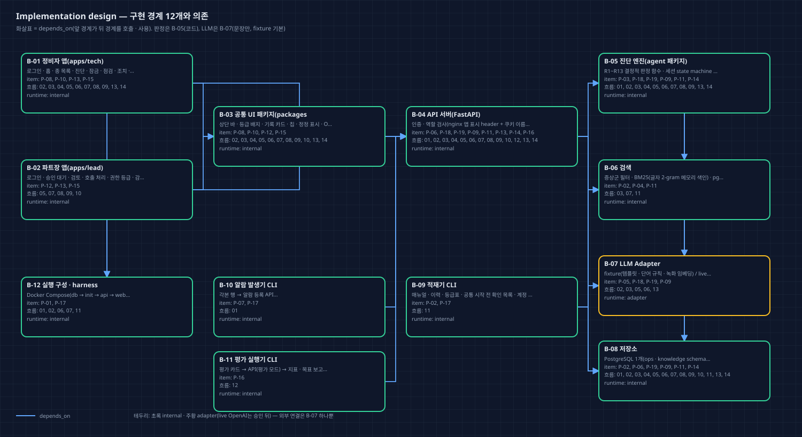
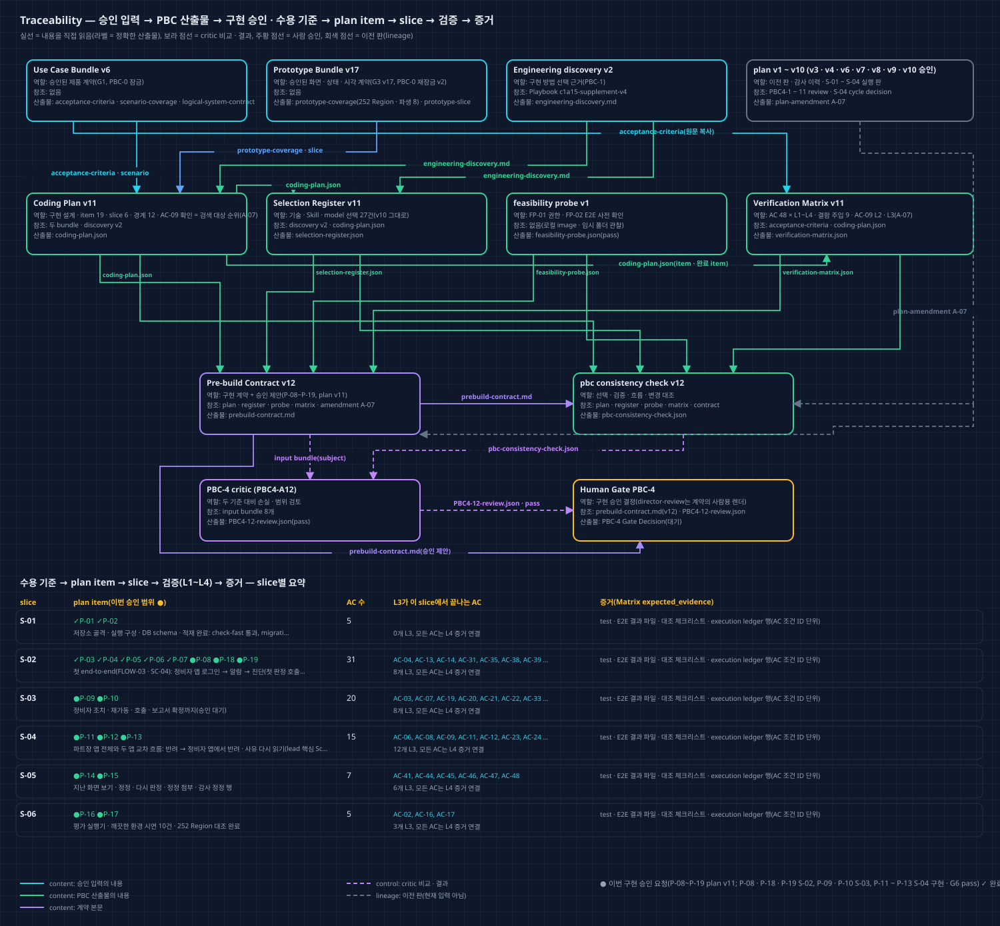
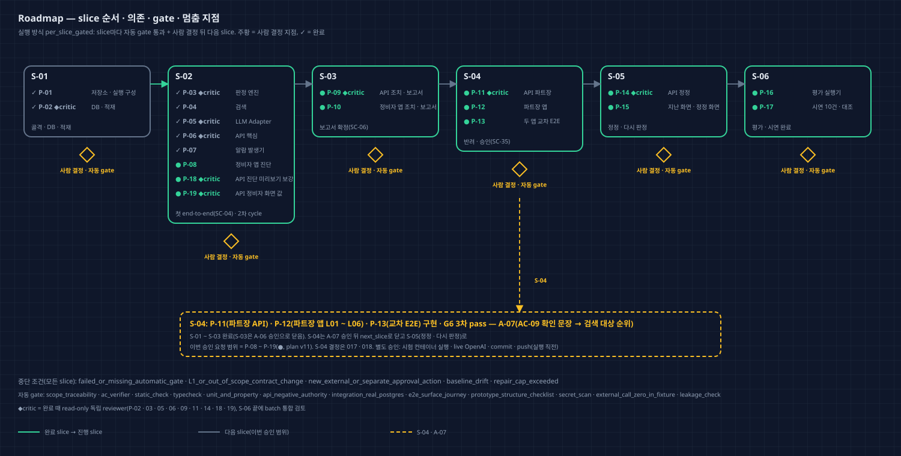

# Coding Plan v11 — Director Review

Run `2026-10-11-c1a15-product-r2` · PBC-4 · approval attempt `PBC4-A12`(L1 plan amendment A-07, 부모 PBC4-A11 pass · 승인, plan v10) · 독립 검토 pass(`critics/PBC4-12-review.json`) · 계약 `prebuild/v12/prebuild-contract.md` · 2026-10-14.

이 문서와 그림 4장은 critic pass 뒤 같은 plan v11에서 한 번 렌더했다. 승인된 v10과 달라진 점은 `coding-plan/amendments/A-07/plan-amendment.md`에 있다. 계기는 S-04 G7 amendment(`execution/S-04/history/cycle-decision-v1.md`)다.

## 한눈에 보기

- **왜 다시 계획했나:** AC-09-C1('승인 뒤 같은 증상군 알람의 검색 후보에 그 보고서가 포함')을 계획은 '다음 알람 진단 화면 상위 10건에 다시 읽힘'으로 확인하게 적었다. S-04에서 보니 승인 보고서는 검색 대상에 들어 순위가 매겨지지만 상위 10건 밖이었다(시험 질의 합친 20위). 그래서 그 확인 문장이 충족되지 않았다(UF-S04-01 L1).
- **바뀐 것(v10 대비):**
  - P-11 · P-12 · P-13 verifier 문장과 Matrix AC-09 L2 · L3 기대 증거를 결정 018 ⑥('검색 대상에 들어 순위가 매겨지고 R-번호 기록이 열림, 상위 10건은 보장 안 함')으로 맞췄다.
  - 이전 승인에서 미룬 정리: 실행 상태(execution_status)를 구조 필드로 정리했고, note 근거를 history 사본 경로로 바꿨다.
- **그대로인 것:** AC 원문 · 관찰 조건, item 계약(compiled_product_contract), 경계, slice, 기술 선택, 결함 주입, 실행 방식, 금지 · 별도 승인 행동, 구현한 item의 동작(S-04에서 만든 P-11 · P-12 · P-13 그대로).
- **이번 승인 범위:** **P-08 ~ P-19**(plan v11), `per_slice_gated`. 승인 뒤 S-04 cycle decision을 next_slice로 다시 써 S-04를 닫고, S-05 G4는 지시 때 한다.
- **검토 이력:** … A11 pass(v10, 승인), **A12 pass(v11)**.

## 사용자 기대와 계획의 대응

| 사용자가 이 단계에서 기대한 것 | 계획 artifact / ID | 확인 방법 |
| --- | --- | --- |
| 승인 보고서가 다음 같은 증상군 알람의 검색 대상이 된다(결정 018 ⑥) | Matrix AC-09 L2 · L3, P-11 · P-12 · P-13 verifier | S-04 test_lead_overview_rows_and_approve_adds_history(r3_positions 승인 전 · 뒤) · 교차 E2E 첫 시험 |
| 검색 규칙(R3) · AC 원문은 바꾸지 않는다('검증 문구만 고침') | AC 48 · P-04 계약 | v10 대비 JSON diff(verifier 3 · AC-09 L2 · L3만) |
| 미룬 정리를 이번 판에서 한다('A-07에 함께 정리') | execution_status · LR-07 정정 절 | consistency check change_representation |
| 구현한 item 동작은 그대로 | P-01 ~ P-13 · P-18 · P-19 | compiled_product_contract diff 0 |

## What remains fixed

다음이 고정된다.
- 승인 Use Case Bundle v6 · Prototype Bundle v17(`approved-inputs/approved-artifact-manifest.json` v2)의 AC · 흐름 · 권한 · 데이터 의미 · 화면 구조 · Component foundation · 표시 조정 · 생성자 해석
- T04 / first_call 규칙 예외(그 상태에서만)

기준선은 `discovery/planning-baseline.json` v3(HEAD f73c240, S-01 ~ S-04 산출물은 commit 전)이다.

## What this plan will and will not do

- **한다:** 아래 plan item. ✓는 완료, ●는 이번 승인 요청이다.
- **하지 않는다:**
  - 배포 · 외부 메시지 · 실제 설비 연동 · Non-goals
  - 앱이 화면 값을 직접 만드는 일
  - 완료 item 계약 바꾸기
  - 승인 전 live OpenAI 사용
  - 다른 저장소 · Wiki 고치기

| Item | 내용 | Slice | 상태 | 검토 | AC |
| --- | --- | --- | --- | --- | --- |
| P-01 | 저장소 · 실행 구성 | S-01 | ✓ 완료 | automatic | 2 |
| P-02 | DB · 적재 | S-01 | ✓ 완료 | independent_critic | 4 |
| P-03 | 판정 엔진 | S-02 | ✓ 완료 | independent_critic | 16 |
| P-04 | 검색 | S-02 | ✓ 완료 | automatic | 3 |
| P-05 | LLM Adapter | S-02 | ✓ 완료 | independent_critic | 3 |
| P-06 | API 핵심 | S-02 | ✓ 완료 | independent_critic | 10 |
| P-07 | 알람 발생기 | S-02 | ✓ 완료 | automatic | 3 |
| P-08 | 정비자 앱 진단(T04 / first_call 포함) | S-02 | ● 승인 요청(구현 · 검증 완료) | automatic | 22 |
| P-18 | API 진단 미리보기 보강 | S-02 | ● 승인 요청(구현 · 검증 완료) | independent_critic | 3 |
| P-19 | API 정비자 화면 값(+ 순위 원인 이름) | S-02 | ● 승인 요청(구현 · 검증 완료) | independent_critic | 7 |
| P-09 | API 조치 · 보고서 · 호출 요약 | S-03 | ● 승인 요청(구현 · 검증 완료) | independent_critic | 18 |
| P-10 | 정비자 앱 조치 · 보고서 · 호출 | S-03 | ● 승인 요청(구현 · 검증 완료) | automatic | 18 |
| P-11 | API 파트장(AC-09 확인 = 검색 대상 순위) | S-04 | ● 승인 요청(구현 · G6 pass) | independent_critic | 13 |
| P-12 | 파트장 앱 | S-04 | ● 승인 요청(구현 · G6 pass) | automatic | 12 |
| P-13 | 두 앱 교차 E2E | S-04 | ● 승인 요청(구현 · G6 pass, verifier ② = A-07 문장) | automatic | 7 |
| P-14 | API 정정(+ 정정 호출 승인 이어 가기 · summary_corrected 값) | S-05 | ● 승인 요청 | independent_critic | 5 |
| P-15 | 지난 화면 · 정정 화면 | S-05 | ● 승인 요청 | automatic | 7 |
| P-16 | 평가 실행기 | S-06 | ● 승인 요청 | automatic | 3 |
| P-17 | 시연 10건 · 대조 | S-06 | ● 승인 요청 | automatic | 2 |

## Implementation design

경계 12개는 v10과 같다.

## Why this engineering approach

v10과 같다. 새 기술 선택은 없다.

## Engineering, skills, and model roles

Selection Register v11은 record 27건(채택 21 · 제외 6)이고, version 값 외에 v10과 같다. Playbook `c1a15-supplement-v4`도 그대로다.

## Traceability map

- 실선은 내용을 직접 읽는 관계이고, 라벨은 정확한 산출물 이름이다. 보라 점선은 critic 비교 · 결과, 회색 점선은 이전 판이다.
- 아래 표는 slice별 item(✓ 완료 · ● 이번 승인 요청) · AC 수 · 그 slice에서 끝나는 L3 AC다. 모든 AC는 L4 증거 연결을 갖는다.
- orphan 산출물 · unknown 관계는 없다.

## Delivery roadmap

S-01 ~ S-03은 완료됐고, S-04(P-11 · P-12 · P-13)는 구현 · G6 3차 pass 뒤 이 수정을 기다린다. 다음은 S-05(P-14 · P-15)다. slice마다 자동 gate가 통과하고 사람이 결정한 뒤 다음으로 간다. ◆critic item은 완료 때 read-only 독립 reviewer가 검토한다.

## Risks, authority boundaries, and stop conditions

- **실행 방식:** `per_slice_gated`
- **이번 승인 요청 item:** P-08, P-09, P-10, P-11, P-12, P-13, P-14, P-15, P-16, P-17, P-18, P-19
- **중단 조건:** failed_or_missing_automatic_gate · L1_or_out_of_scope_contract_change · new_external_or_separate_approval_action · baseline_drift · repair_cap_exceeded
- **금지:**
  - 승인 Use Case Bundle v6 · Prototype Bundle v17의 AC · 사용자 흐름 · 권한 의미 · 데이터 의미 · 화면 구조 · 시각 규칙 변경
  - T04 / first_call의 규칙 예외(R-NEXT의 C · D 점검 정보 · '점검 시작'의 호출 경고 토큰)를 그 상태 밖 화면 · 상태에 쓰기
  - 완료된 P-01 ~ P-07의 계약 바꾸기(바꿀 일이 생기면 L1 amendment)
  - eval/cards · generation/cause_ratio_table.json을 진단 처리 · 색인 · 적재기에서 읽기
  - 비밀번호 · API 키 원문을 저장소 · 로그 · DB에 쓰기
  - fixture 시험 · 시연에서 외부 네트워크 호출
  - plan item 밖 파일 · 다른 저장소 수정, Wiki 쓰기
  - 배포 · 외부 메시지 전송
- **별도 승인(실행 직전):**
  - live OpenAI 문장 · 임베딩 smoke(소수 · 격리, 키는 사용자 제공)
  - live 모드 평가 실행
  - npm · uv 패키지 설치, Python 3.12 내려받기
  - Docker image pull(python · node 빌드 image 등 로컬에 없는 것)
  - Playwright 브라우저 내려받기(1.63.0 밖의 판을 쓸 때)
  - git commit · push
  - Docker 컨테이너로 시험 DB · 시험 스택 실행(첫 실행 전 한 번)

**이어 가는 실행 해석(v8 ~ v11 승인):** PW 센서 표 5행 · hash 예상 변경 대조 · 홈 값 채우기 확인 · cause_names = 카드 원인 이름 시험 · 상단 바 표시 · AC-37 L2 줄 '부분' 표기 · 답 온 호출 L2는 시험 DB 기록 · P-03 계약 그대로(결정 016 ①은 P-09에만). 미룬 정리(execution_status · LR-06 판 범위)는 이번 판에서 처리했다.

### 독립 검토(PBC4-A12)의 비차단 의견

1. **제품 의미 확정:**
   - 승인 어휘에서 '비슷한 과거 기록'은 상위 10건을 뜻하기도 한다(AC-40, 찾은 기록 수 10).
   - 새 확인은 사실상 '승인 전 없음 → 승인 뒤 같은 증상군 검색 대상에 들어감'의 대조다. pgvector 순위는 같은 증상군 전체를 돌려줘 몇 위든 통과한다.
   - 그래서 이번 승인은 'AC-09-C1은 상위 10건 · 진단 카드 포함을 약속하지 않는다'를 사용자가 확정하는 일이다. 이 점을 승인 기록 reviewer note에 한 줄로 남기기를 권한다.
   - Matrix AC-09 L3의 'R-번호 기록으로 다시 읽힘'은 화면이 아니라 기록 창이 쓰는 API로 연다.
2. **순위 숫자의 출처:**
   - 결정 018 ⑥은 합친 19위 · BM25 2위(G5 세션 질의)다.
   - A-07은 합친 20위 · BM25 3위 · pgvector 82위(시험 질의)다.
   - 이 차이와 pgvector 순위의 한계는 ledger에만 있다. S-04를 닫을 때 report AC-09에 실행 명령 · DB와 함께 옮기기를 권한다.
3. **LR-07 문장 정밀도:**
   - 확인을 '진단 과거 기록 후보'로 좁혀 적은 곳은 Matrix AC-09 L3와 P-12 verifier다. P-11 · P-13 ②는 AC 원문 표현이었다.
   - 놓친 일에 판별력 없던 첫 L2 의미 색인 검사(G6 B1)를 더하면 재발 방지 제안과 잘 이어진다.

## 승인자에게 요청할 결정

1. **구현 승인:** 승인 / 수정 요청 / 보류 / 제품 변경 요청 중에서 고른다. 대상은 plan v11의 P-08 ~ P-19다.
2. **실행 해석(비차단 의견 처리):**
   - ① 승인 기록 reviewer note에 'AC-09-C1은 R3 검색 대상 포함 · 순위 매김을 약속하고, 진단 상위 10건 · 카드 포함은 약속하지 않는다(사용자 확정)'를 적는다. Matrix L3의 R-번호 기록은 기록 창이 쓰는 API로 연다고 함께 적는다.
   - ② S-04를 next_slice로 닫을 때 report AC-09에 순위 출력의 실행 명령 · DB, 19위(G5 세션 질의)와 20위(시험 질의)의 차이, pgvector 순위 한계를 옮긴다.
   - ③ LR-07 정밀도(좁힌 곳 = Matrix L3 · P-12, 놓친 일에 첫 L2 검사)는 LR-07이 consistency check hash로 잠겨 있어 다음 학습 기록의 정정 절로 둔다.

## Approval effect

- 승인하면 plan v11의 P-08 ~ P-19를 slice마다 사람 결정을 거치며 구현할 수 있다. Gate Decision의 `implementation_authorization`은 이 문서의 proposal과 같은 값이어야 한다.
- 승인으로 허용되지 않는 것은 위 '별도 승인(실행 직전)' 목록 그대로다. 이 행동들은 각각 실행 직전에 따로 묻는다.
