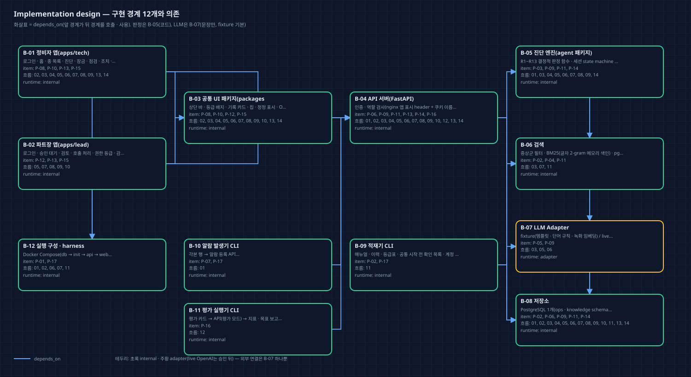
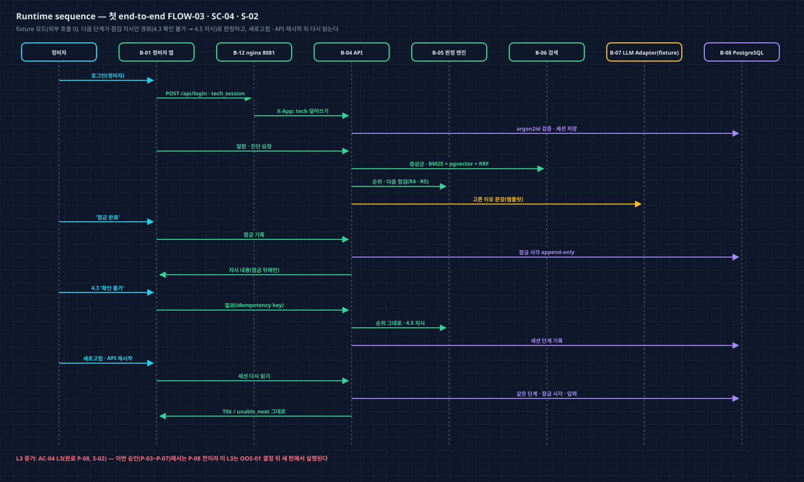
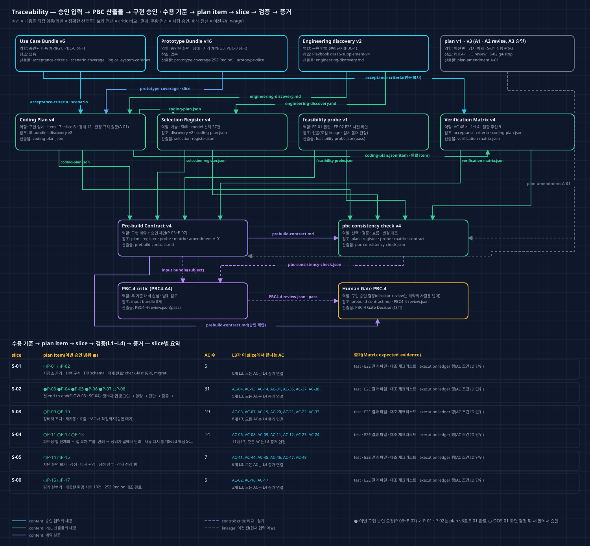
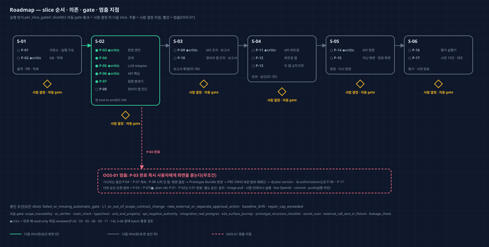

# Coding Plan v4 — Director Review

Run `2026-10-11-c1a15-product-r2` · PBC-4 · approval attempt `PBC4-A4`(L1 plan amendment A-01) · 독립 검토 pass(`critics/PBC4-4-review.json`) · 2026-10-13. 이 문서와 그림 4장은 critic pass 뒤 같은 plan v4에서 한 번 렌더했다(plan은 고치지 않음). v3와 달라진 점: `coding-plan/amendments/A-01/plan-amendment.md`.

## 한눈에 보기

- **무엇을:** 승인한 Use Case v6(AC 48)과 Prototype v16(화면 69 + 파생 7, Region 252)을 구현 계획 17개 item · 6개 slice로 옮겼다. 두 앱(정비자 · 파트장), API 서버 하나, PostgreSQL 하나, CLI 세 개다.
- **A-01에서 바뀐 것:** 명세 4장 판정 규칙 R1 ~ R13 원문을 9개 item(P-03 · 04 · 05 · 06 · 07 · 09 · 11 · 14 · 16)의 behavior에 그대로 옮겼다. S-02 G4가 규칙 본문이 없어 멈췄기 때문이다. 그 밖의 계약 · 검증은 v3와 같다.
- **이번에 승인을 구하는 범위:** **P-03 ~ P-07**(S-02의 화면 없는 item: 판정 엔진 · 검색 · LLM Adapter · API · 알람 발생기)이다. P-01 · P-02는 plan v3 승인으로 S-01에서 완료됐다. 실행 방식은 `per_slice_gated`다.
- **멈춤 지점 OOS-01:** 판정 엔진(P-03)이 끝나면 즉시 '첫 판정이 바로 호출인 진단 화면'을 어떻게 할지 여쭙는다. 그 결정이 Prototype을 바꾸므로, P-08 이후(화면 · 교차 E2E · 정정 · 평가 · 시연)는 그 뒤 새 plan 판에서 승인받는다.
- **검토 이력:** 독립 검토를 세 번 받았다.
  - PBC4-A1 revise: 막는 지적 4건. 계약 본문 미렌더 변수, AC-03 · AC-42 연결, surface 핵심 Scenario, OOS-01 멈춤 지점이었다.
  - PBC4-A2 revise: 막는 지적 1건. consistency check 판정 문장이 v1 값으로 남아 있었다.
  - PBC4-A3 pass(v3 승인 · S-01 실행).
  - PBC4-A4 pass(L1 amendment A-01, plan v4).
  두 revise는 모두 생성자 스크립트 실수였고, 승인 제품 계약은 한 번도 바뀌지 않았다.

## 사용자 기대와 계획의 대응

| 사용자가 이 단계에서 기대한 것 | 계획 artifact / ID | 확인 방법 |
| --- | --- | --- |
| 승인한 화면 · 흐름 그대로 구현(D1 · D17) | Coding Plan items[].compiled_product_contract · prototype_refs(252 Region 전부) | Matrix AC-17 L3 대조 체크리스트(P-17) |
| 두 앱은 완전히 별도 제품(D3) | B-01 · B-02 · nginx 8081/8082 · 앱별 쿠키 + 서버 앱 · 역할 대조 | FP-01 pass · ADV-06 · AC-12 L2/L3 |
| 판정은 코드, LLM은 문장만 | B-05 판정 함수 · B-07 LLM Adapter(fixture 기본) | AC-03 · 04 L1, ADV-05 · 07 |
| 키 없이 시연 · 평가(D10) | APP_MODE=fixture · 외부 호출 0 gate | AC-16 L3(P-17) |
| 정답 누수 없음 | 적재 · 검색 · 평가 실행기 분리 | AC-15 · ADV-02 · 04 · 09 |
| 상단 홈 · 지난 화면 · 정정(010 · 011) | P-14 · P-15 · AC-41 ~ 48 | Matrix L2 서버 거부 · L3 E2E |
| 사용자가 정한 기술 9개(Playbook v4) | Selection Register v4(27건, v3와 같음) | 각 record의 playbook_refs |
| 판정은 명세 규칙대로(D4 · D5 등) | P-03 등 9개 item의 '판정 규칙' 절(명세 4장 원문) | AC-03 · 04 · 19 · 20 · 22 · 28 · 29 L1 등 |
| 설치 · pull · live 호출 · push는 따로 묻기 | 계약 separate_approval_required_for 7건 | 실행 직전 질문 |

## What remains fixed

승인 Use Case Bundle v6 · Prototype Bundle v16(`approved-inputs/approved-artifact-manifest.json`)의 AC · 흐름 · 권한 · 데이터 의미 · 화면 구조 · Component foundation · 표시 조정 · 생성자 해석 4가지 · 이월 메모 처리(CO-22 · 31 · 32 · 36 · 37 · 38 · 39)가 고정된다. 기준선은 `discovery/planning-baseline.json` v2(HEAD f73c240)다.

## What this plan will and will not do

- **한다:** 아래 plan item. 그중 이번 승인 요청은 ●뿐이다.
- **하지 않는다:** 배포 · 외부 메시지 · 실제 설비 연동 · Non-goals. 사용자 결정 없이 OOS-01 화면을 만들지 않는다. live OpenAI는 승인 전에 쓰지 않는다. 다른 저장소 · Wiki를 고치지 않는다.

| Item | 내용 | Slice | 이번 승인 | 검토 | AC |
| --- | --- | --- | --- | --- | --- |
| P-01 | 저장소 · 실행 구성 | S-01 | ○ 새 판에서 | automatic | 2 |
| P-02 | DB · 적재 | S-01 | ○ 새 판에서 | independent_critic | 4 |
| P-03 | 판정 엔진 | S-02 | ● 승인 요청 | independent_critic | 16 |
| P-04 | 검색 | S-02 | ● 승인 요청 | automatic | 3 |
| P-05 | LLM Adapter | S-02 | ● 승인 요청 | independent_critic | 3 |
| P-06 | API 핵심 | S-02 | ● 승인 요청 | independent_critic | 10 |
| P-07 | 알람 발생기 | S-02 | ● 승인 요청 | automatic | 3 |
| P-08 | 정비자 앱 진단 | S-02 | ○ 새 판에서 | automatic | 21 |
| P-09 | API 조치 · 보고서 | S-03 | ○ 새 판에서 | independent_critic | 17 |
| P-10 | 정비자 앱 조치 · 보고서 | S-03 | ○ 새 판에서 | automatic | 17 |
| P-11 | API 파트장 | S-04 | ○ 새 판에서 | independent_critic | 13 |
| P-12 | 파트장 앱 | S-04 | ○ 새 판에서 | automatic | 12 |
| P-13 | 두 앱 교차 E2E | S-04 | ○ 새 판에서 | automatic | 7 |
| P-14 | API 정정 | S-05 | ○ 새 판에서 | independent_critic | 5 |
| P-15 | 지난 화면 · 정정 화면 | S-05 | ○ 새 판에서 | automatic | 7 |
| P-16 | 평가 실행기 | S-06 | ○ 새 판에서 | automatic | 3 |
| P-17 | 시연 10건 · 대조 | S-06 | ○ 새 판에서 | automatic | 2 |

## Implementation design

modular monolith 하나다. 두 앱은 공통 UI 패키지(B-03)를 거쳐 API 서버(B-04)로 모인다. API는 판정 엔진(B-05) · 검색(B-06) · LLM Adapter(B-07) · 저장소(B-08)를 쓴다. 비UI는 적재기(B-09) · 알람 발생기(B-10) · 평가 실행기(B-11)이고, 실행 구성은 B-12다. 외부 연결은 B-07(live, 승인 뒤) 하나뿐이다.

| 경계 | 책임 | runtime | item | 의존 |
| --- | --- | --- | --- | --- |
| B-01 | 정비자 앱(apps/tech) | internal | P-08, P-10, P-13, P-15 | B-03, B-04, B-12 |
| B-02 | 파트장 앱(apps/lead) | internal | P-12, P-13, P-15 | B-03, B-04, B-12 |
| B-03 | 공통 UI 패키지(packages/ui) | internal | P-08, P-10, P-12, P-15 | B-04 |
| B-04 | API 서버(FastAPI) | internal | P-06, P-09, P-11, P-13, P-14, P-16 | B-05, B-06, B-07, B-08 |
| B-05 | 진단 엔진(agent 패키지) | internal | P-03, P-09, P-11, P-14 | B-06, B-07, B-08 |
| B-06 | 검색 | internal | P-02, P-04, P-11 | B-07, B-08 |
| B-07 | LLM Adapter | adapter | P-05, P-09 | — |
| B-08 | 저장소 | internal | P-02, P-06, P-09, P-11, P-14 | — |
| B-09 | 적재기 CLI | internal | P-02, P-17 | B-08, B-06 |
| B-10 | 알람 발생기 CLI | internal | P-07, P-17 | B-04 |
| B-11 | 평가 실행기 CLI | internal | P-16 | B-04 |
| B-12 | 실행 구성 · harness | internal | P-01, P-17 | — |

**첫 end-to-end:** FLOW-03 · SC-04 · S-02, 경계 B-01 → B-03 → B-04 → B-05 → B-06 → B-07 → B-08.
- 결과: 정비자가 정비자 앱에서 알람의 진단을 열고 잠금을 확인한 뒤 지시된 점검 결과를 넣으면, 서버가 결과를 세션 단계 기록에 저장하고 순위를 다시 계산해 다음 점검 지시를 낸다(fixture 문장). S-02 L3는 다음 단계가 점검 지시인 경로(예: 4.3 '확인 불가' → 순위 그대로 · 4.5 지시, T06 / unable_next)로 판정한다. 다음 단계가 호출 요약인 경로(4.3 정상 → 호출)는 호출 요약 화면이 있는 S-03(P-10)에서 L3로 판정한다.
- 다시 읽기: 새로고침 · 앱 재시작 · API 재시작 뒤 같은 세션의 같은 단계 · 잠금 시각 · 입력 결과 · 재계산 순위가 서버 기록에서 다시 읽힌다(AC-14).
- 이 L3는 P-08 완료 때 실행된다. 그래서 이번 승인(P-03 ~ P-07)으로는 실행되지 않고, OOS-01 결정 뒤 새 판에서 실행된다.

**UI surface 통합(승인 Prototype의 핵심 Scenario 그대로):**

| Surface | 핵심 Scenario | 통합 slice | 진입 → 다시 읽기 | 검증 |
| --- | --- | --- | --- | --- |
| tech | SC-06 | S-03 | B-01 → B-04 | AC-07, AC-33 (L3) |
| lead | SC-35 | S-04 | B-02 → B-01 | AC-11, AC-24 (L3) |

**전달 · 복구:** slice마다 작은 commit(사용자 지시 때만), 깨진 slice 위로 진행하지 않음. 되돌림은 이전 commit · Alembic downgrade · compose down -v 후 재적재. 배포 없음(local 시연). push · 설치 · image pull · live 호출은 별도 승인.

## Why this engineering approach

- 경로 · 순서가 명세로 정해져 있다. 그래서 agent를 쓰지 않고 결정적 workflow + 순수 함수 판정으로 간다(P-03, EP-WORKFLOW-001 · EP-C1-RULE-001).
- LangGraph는 명세대로 중단 · 재개 껍데기로만 쓰고, 감사 정본은 append-only 업무 기록이다(P-03 · P-09 · P-14, EP-C1-HITL-001).
- 실제 PostgreSQL 컨테이너로 시험하고 E2E는 surface별 대표 journey만 둔다. 규칙은 unit · property로 확인한다(EP-TEST-001).
- 권한 경계는 서버가 정본이다. nginx 앱 표시 header와 앱별 쿠키 이름은 보조다(FP-01이 '다른 앱 쿠키도 서버까지 온다'를 확인, P-06).
- 제외: single · multi-agent, hook, MCP, worktree 병렬, 추가 Skill, SSE · WebSocket. 모두 관찰된 필요가 없다.

## Engineering, skills, and model roles

Selection Register v4: 15개 범주 모두 검토, record 27건(채택 21 · 제외 6). Playbook `c1a15-supplement-v4`(SHA-256 `5420be68c375…`, 2026-10-12 사용자 '내용 그대로 사용 승인').

| 범주 | record(✓ 채택 · ✕ 제외) |
| --- | --- |
| frontend | ✓ SEL-FE, ✓ SEL-API-TYPES |
| graph | ✓ SEL-GRAPH |
| harness | ✓ SEL-HARNESS, ✓ SEL-PY |
| hook | ✕ SEL-X-HOOK |
| loop | ✓ SEL-LOOP |
| mcp | ✕ SEL-X-MCP |
| model_development | ✓ SEL-DEVMODEL |
| model_product | ✓ SEL-LLM |
| resilience_ops | ✓ SEL-OPS, ✓ SEL-SYNC, ✕ SEL-X-PUSH |
| skill | ✕ SEL-X-SKILL |
| state_data | ✓ SEL-DB, ✓ SEL-DATALOAD, ✓ SEL-RET, ✓ SEL-AUTH |
| subagent | ✓ SEL-SUBAGENT |
| test | ✓ SEL-TEST-UNIT, ✓ SEL-TEST-API, ✓ SEL-TEST-E2E, ✓ SEL-TEST-NEG, ✓ SEL-TEST-EVAL |
| workflow | ✓ SEL-WORKFLOW, ✕ SEL-X-AGENT |
| worktree | ✕ SEL-X-WORKTREE |

- **Skill:** 환경에서 확인한 Skill 71개 중 구현에 추가로 쓰는 것은 없다(SEL-X-SKILL). `artifact-dependency-tree`는 이 검토 자료의 그림(PBC 절차)에만 썼다.
- **제품 model:** LLM Adapter가 문장 · 임베딩만 맡는다. fixture가 기본이고 live는 승인 뒤다(SEL-LLM).
- **개발 model:** 현재 환경 model(claude-opus-5-5)을 쓴다. 품질은 verifier와 read-only 독립 reviewer로 보장한다(SEL-DEVMODEL · SEL-SUBAGENT).

## Traceability map

- 실선은 내용을 직접 읽는 관계이고, 라벨은 정확한 산출물 이름이다.
- 보라 점선은 critic 비교 · 결과, 회색 점선은 이전 판(v1 · v2, 현재 입력 아님)이다.
- 아래 표는 slice별 item(● 이번 승인 요청) · AC 수 · 그 slice에서 끝나는 L3 AC를 보인다. 모든 AC는 L4 증거 연결(execution ledger)을 갖는다.
- 재사용 감사: `coding-plan.json` · `verification-matrix.json` · `selection-register.json` · `feasibility-probe.json`은 계약과 consistency check가 함께 읽는다. check가 같은 hash를 대조하므로 중복 읽기가 의도된 것이다.
- orphan 산출물은 없다. unknown 관계도 없다.

## Delivery roadmap

slice마다 자동 gate가 통과하고 사람이 결정한 뒤 다음 slice로 간다. 초록은 이번 승인 범위, 회색은 새 판 승인 뒤, 빨강 점선은 OOS-01 멈춤(P-03 완료 즉시)이다. ◆critic item은 완료 때 read-only 독립 reviewer가 검토한다.

## Risks, authority boundaries, and stop conditions

- **실행 방식:** `per_slice_gated`
- **이번 승인 요청 item:** P-03, P-04, P-05, P-06, P-07
- **자동 gate:** scope_traceability · ac_verifier · static_check · typecheck · unit_and_property · api_negative_authority · integration_real_postgres · e2e_surface_journey · prototype_structure_checklist · secret_scan · external_call_zero_in_fixture · leakage_check
- **critic 승격 조건:** external_or_authority · sensitive_or_irreversible · public_contract_or_migration · unverifiable_material_ui_or_ai_judgment · performance_budget · unexpected_failure
- **중단 조건:** failed_or_missing_automatic_gate · L1_or_out_of_scope_contract_change · new_external_or_separate_approval_action · baseline_drift · repair_cap_exceeded
- **금지:** 승인 Use Case Bundle v6 · Prototype Bundle v16의 AC · 사용자 흐름 · 권한 의미 · 데이터 의미 · 화면 구조 · 시각 규칙 변경; OOS-01(첫 판정이 바로 호출인 진단 화면)을 사용자 결정 없이 만들기; eval/cards · generation/cause_ratio_table.json을 진단 처리 · 색인 · 적재기에서 읽기; 비밀번호 · API 키 원문을 저장소 · 로그 · DB에 쓰기; fixture 시험 · 시연에서 외부 네트워크 호출; plan item 밖 파일 · 다른 저장소 수정, Wiki 쓰기; 배포 · 외부 메시지 전송
- **별도 승인(실행 직전):** live OpenAI 문장 · 임베딩 smoke(소수 · 격리, 키는 사용자 제공); live 모드 평가 실행; npm · uv 패키지 설치, Python 3.12 내려받기; Docker image pull(python · node 빌드 image 등 로컬에 없는 것); Playwright 브라우저 내려받기(1.63.0 밖의 판을 쓸 때); git commit · push; Docker 컨테이너로 시험 DB · 시험 스택 실행(첫 실행 전 한 번)
- **OOS-01:** OOS-01(사용자 결정 2026-10-12, coding-plan/v1/decisions/pbc4-user-decisions.md · coding-plan/v2/decisions/pbc4-a2-user-decisions.md · coding-plan/v3/decisions/pbc4-a3-user-decisions.md): 첫 판정이 바로 파트장 호출인 진단 화면(T04에 보일 A · B 점검이 없음 — 1순위 원인을 확인할 점검이 C · D뿐이고 50% 이상이거나 A · B 점검이 없을 때)은 승인 화면에 없어 이 plan으로 구현하지 않는다. 멈춤 지점: P-03(S-02)이 완료되면 즉시 사용자에게 묻는다. 묻는 동안 화면이 없는 P-04 ~ P-07은 계속하고, P-08(진단 화면 T04를 포함한 정비자 앱 화면)은 시작하지 않는다. 물을 때 P-03 함수로 계산한 시연 각본 10건 · E2E fixture의 첫 판정 결과를 보이고, 등급 변경으로도 생길 수 있음을 알리며, 이 화면을 G3 파생 상태로 정하도록 사용자에게 묻는다. 그 결정은 Prototype Bundle 변경이므로 승인 입력이 바뀌고 PBC-0부터 바뀐 범위만 다시 확인한다. 그래서 이 plan의 구현 승인 요청은 P-01 ~ P-07뿐이며, P-08 이후는 화면 결정 뒤 새 plan version · 새 implementation authorization으로 승인받는다. 결정 전에는 이 경로를 앱에 넣지 않는다(빈 '다음 점검' 카드 · 임의 화면 · T10 건너뛰기 금지). 서버의 호출 판정 함수와 호출 요약 화면(T10)은 승인대로 만든다.

**독립 검토(PBC4-A4)의 비차단 의견** — plan은 고칠 수 없다. 1 · 3번의 정리는 다음 plan 판에서, 2번은 아래 실행 해석으로 승인 때 함께 정한다.

1. 옮긴 규칙 본문은 원문과 같습니다. 9개 item(P-03 · 04 · 05 · 06 · 07 · 09 · 11 · 14 · 16)의 '판정 규칙' 절을 sources/intent/002.md 4장 R1~R13(R5 계산 예시 포함)과 한 줄씩 대조했고, 누락 · 변형 · 추가는 없었습니다. item별 규칙 묶음도 각 item의 AC · 책임과 맞습니다. 다만 R11은 P-07에만 들어가 있어 뒤의 두 줄을 쓰는 item에 연결되지 않았습니다. 하나는 '재가동 후 표시 값: 각본 값, 없으면 경계 + 여유 10%'입니다. 이 값을 정하는 일('재가동 후 표시 값 결정')은 FLOW-04에서 P-09(진단 처리) 몫이고 AC-21-C2와 관련됩니다. 다른 하나는 '알람 화면 추이 그래프 · 최근 12회'이며 T03 / R-ALARM 값과 관련됩니다. P-09가 쓰는 규칙에 R11이 없으므로, S-03 G4에서 이번과 같은 규칙 본문 누락으로 다시 멈출 수 있습니다. 이번 승인 범위(P-03~P-07)에는 영향이 없습니다. P-08 이후는 OOS-01 때문에 어차피 새 plan version이 필요하므로, 그 판에서 P-09(그리고 추이 값을 만드는 item)에 R11을 원문 그대로 더하고 consistency check의 change_representation에도 반영하는 것이 좋습니다.
2. Preservation statement는 정직합니다. 새 규칙 · 값은 없고, 승인 bundle의 AC · Prototype과 충돌하는 규칙도 없었습니다. 다만 원문을 그대로 옮긴 결과 다르게 읽힐 수 있는 곳이 R3 말고도 하나 더 있는데, statement는 이를 밝히지 않았습니다. R2의 'B 체크리스트 확인 후 지시'는 '체크리스트를 확인하기 전에는 지시 내용을 내려주지 않는다'로 읽힐 수 있습니다. 승인된 AC-43과 T06 R-INSTR은 이와 다릅니다. B 지시(절차 · 판정 기준)는 체크리스트와 함께 보이고, 잠기는 것은 결과 입력 · 진행 버튼뿐입니다. 또 R3 토큰 규칙을 맞춘 해석('공백으로 나눈 단어 + 한글 2-gram')은 amendment 문서에만 있습니다. P-04의 selected_approach는 여전히 '글자 2-gram'입니다. 구현자는 plan item만 읽으므로, 다음 판에서 두 가지를 하는 것이 좋습니다. 첫째, 규칙 절 머리에 '읽기가 갈리면 승인 AC · Prototype이 우선'이라는 한 줄을 둡니다. 둘째, R3 해석을 P-04 item에 넣습니다.
3. 바뀐 범위는 설명과 같습니다. P-03 · P-04 · P-14와 Matrix의 줄 위치 · 내용을 v3와 대조했습니다. Matrix의 AC 48개 · 결함 주입 · 수동 검토 · 별도 승인 7건은 v3와 같고, 별도 승인 7건은 proposal의 separate_approval_required_for와 일치합니다. 구현 승인 제안(P-03~P-07, P-01 · P-02는 v3로 완료)도 명확합니다. 다만 표현 두 곳은 정리하는 것이 좋습니다. 첫째, OOS-01 문장(contract Out of scope, plan의 P-03 · P-08 behavior와 out_of_scope_contract_changes)에 '이 plan의 구현 승인 요청은 P-01 ~ P-07뿐'이 v3 문구 그대로 남아 있습니다. 둘째, PBC4-A3 비차단 의견이 아직 반영되지 않았습니다. 그 의견은 세 가지였습니다. 승인 범위가 S-02 중간(P-07)에서 끝날 때 어떤 자동 gate로 판정하고 멈추는지, ADV-07에서 P-06이 C · D 차례에 무엇을 돌려주는지, Prototype이 바뀌기 시작하면 P-04~P-07을 v16 잠금 그대로 계속하는지입니다. 이 세 가지를 실행 기록에서 같은 뜻으로 판정할 수 있게 한 줄씩 적어 두는 것이 좋습니다.

## 승인자에게 요청할 결정

1. **구현 승인:** 승인 / 수정 요청 / 보류 / 제품 변경 요청 중 하나를 고른다. 대상은 plan v4의 P-03 ~ P-07이고, 실행 방식은 `per_slice_gated`, 중단 조건 · 금지 · 별도 승인 행동은 위 목록과 같다.
2. **실행 해석 5가지(PBC4-A3에서 정한 3가지 + PBC4-A4 비차단 의견 2가지):**
   - ① P-07 완료 때의 gate는 item verifier · ADV-01 ~ 07 · check-fast다(S-02 화면 gate는 새 판에서).
   - ② P-06은 C · D 차례에 '다음 단계 = 호출, 지시 내용 없음'만 돌려주고, 호출 요약 본문은 P-09(새 판)에서 만든다.
   - ③ P-04 ~ P-07 진행 중에 화면 결정으로 Prototype Bundle이 바뀌면, 남은 item은 v16 잠금 그대로 계속하지 않는다. 그때 `L1_or_out_of_scope_contract_change`로 멈추고 변경 범위를 확인한다. P-03 계산표의 대상은 시연 각본 10건 + R5 예시 입력이다.
   - ④ 옮긴 규칙 원문과 승인 AC · Prototype의 읽기가 갈리면 승인 AC · Prototype이 우선한다. 예: R2 'B 체크리스트 확인 후 지시'는 AC-43 · T06 R-INSTR대로 B 지시(절차 · 판정 기준)는 체크리스트와 함께 보이고, 결과 입력 · 진행 버튼만 잠근다.
   - ⑤ R3 토큰 규칙은 '공백으로 나눈 단어 + 한글 2-gram'으로 읽어 P-04의 '글자 2-gram'(사용자 결정 EP-C1-FUSE-001)과 함께 만족시킨다.

## Approval effect

- 승인하면 plan v4의 P-03 ~ P-07 구현만 시작할 수 있다. Gate Decision의 `implementation_authorization`은 이 문서의 proposal과 같은 값이어야 한다.
- 승인으로 허용되지 않는 것: live OpenAI 문장 · 임베딩 smoke(소수 · 격리, 키는 사용자 제공); live 모드 평가 실행; npm · uv 패키지 설치, Python 3.12 내려받기; Docker image pull(python · node 빌드 image 등 로컬에 없는 것); Playwright 브라우저 내려받기(1.63.0 밖의 판을 쓸 때); git commit · push; Docker 컨테이너로 시험 DB · 시험 스택 실행(첫 실행 전 한 번). 이 행동들은 각각 실행 직전에 따로 묻는다.
- P-08 ~ P-17은 OOS-01 화면 결정 → Prototype Bundle 변경 → PBC-0부터 바뀐 범위 재확인 → 새 plan version · 새 authorization 뒤에 시작한다.
