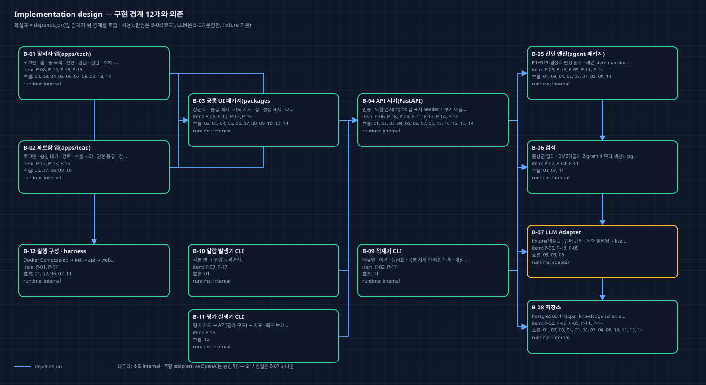
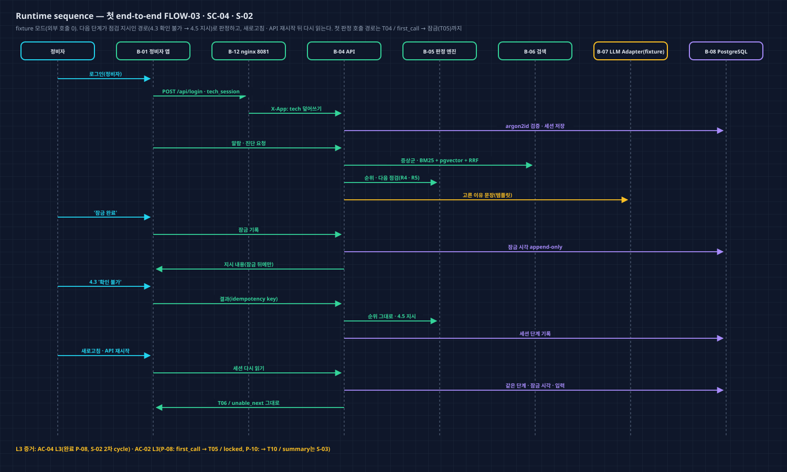
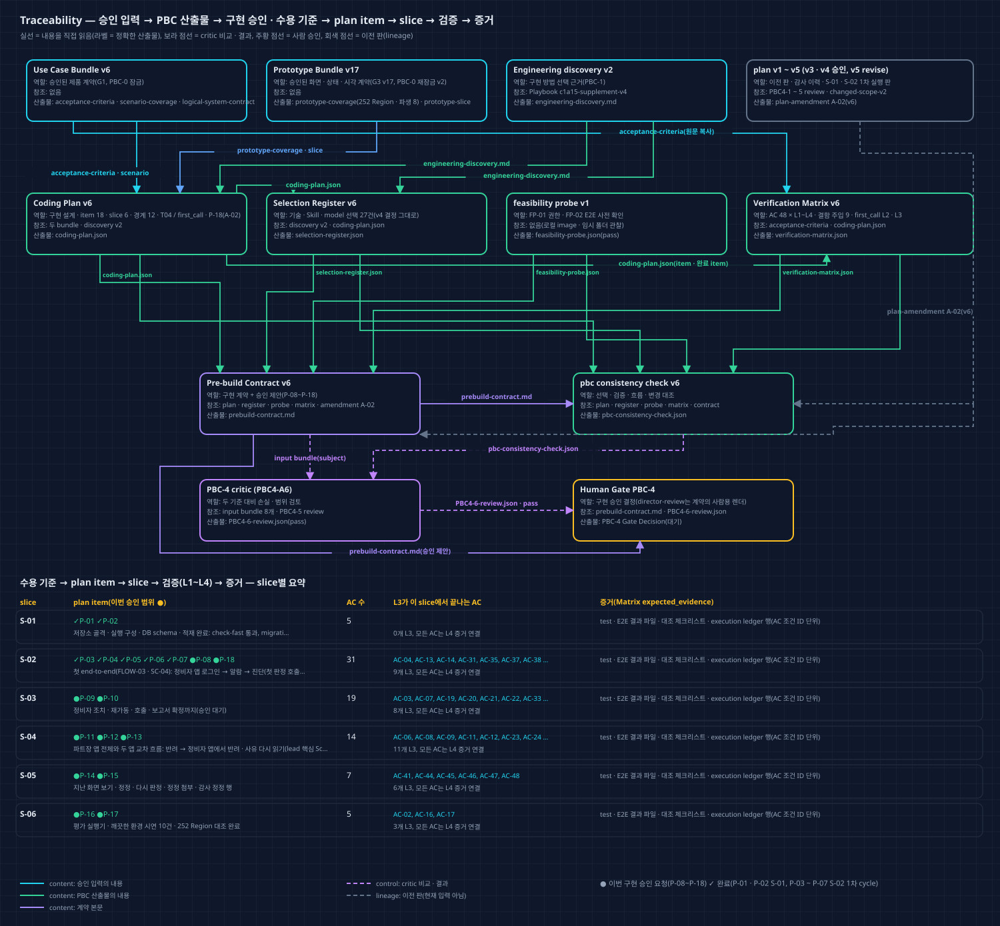
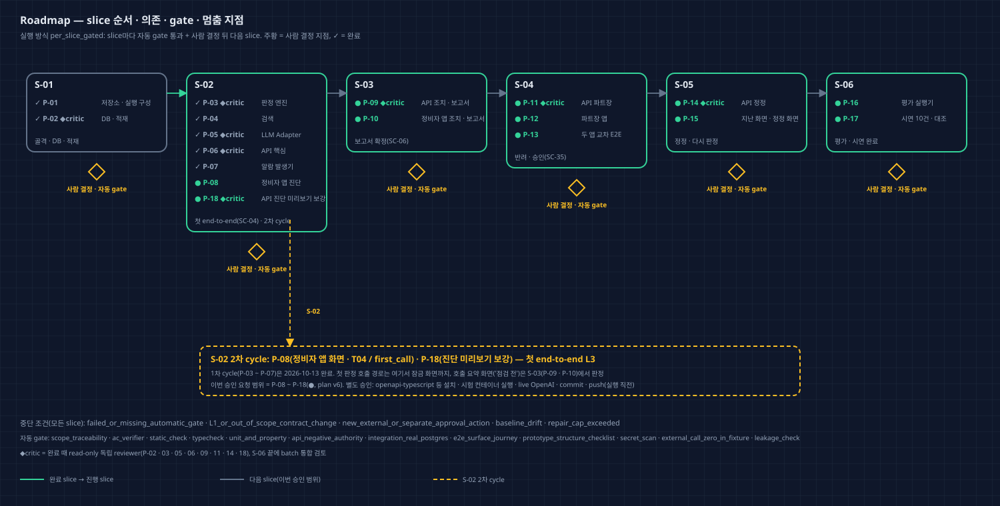

# Coding Plan v6 — Director Review

Run `2026-10-11-c1a15-product-r2` · PBC-4 · approval attempt `PBC4-A6`(L1 plan amendment A-02, 부모 PBC4-A5 revise) · 독립 검토 pass(`critics/PBC4-6-review.json`) · 2026-10-13. 이 문서와 그림 4장은 critic pass 뒤 같은 plan v6에서 한 번 렌더했다(plan은 고치지 않음). 승인된 v4와 달라진 점: `coding-plan/amendments/A-02/plan-amendment-v6.md`, 바뀐 범위: `approved-inputs/changed-scope-v2.md`.

## 한눈에 보기

- **왜 다시 계획했나:** 첫 판정이 바로 파트장 호출인 진단 화면(OOS-01)을 결정 013으로 정했다. 그래서 Prototype이 v17(파생 상태 T04 / first_call)로 바뀌었다. 구현 승인은 P-07까지였으므로, 남은 item을 새 판으로 승인받아야 한다.
- **바뀐 것(v4 대비):**
  - P-08(정비자 앱 화면)에 T04 / first_call을 넣었다. 규칙 예외는 그 상태에서만 쓴다.
  - 새 P-18(진단 미리보기 API 보강)이 첫 판정 호출일 때 확인 점검 이름 · 소요 분 · 근거 검사를 거친 이유를 낸다.
  - P-09 · P-10(호출 요약)에 첫 판정 호출에서 온 '점검 전' 요약을 넣었다.
  - S-02 G6 이월 의견을 해당 item 시험에 넣었다.
  - R11 · 규칙 우선순위 · R3 해석을 정리했다.
- **그대로인 것:** AC 48 · 경계 12 · 기술 선택(Selection Register 27건 결정 그대로) · Playbook v4 · 실행 방식 · 금지 · 별도 승인 행동. 완료된 P-01 ~ P-07의 계약(P-03 · P-04는 문구만).
- **이번 승인 범위:** **P-08 ~ P-18**(남은 item 전부), 실행 방식 `per_slice_gated`. 첫 단계는 **S-02 2차 cycle**(P-08 · P-18)이다. 화면까지 관통하는 첫 end-to-end를 여기서 판정한다.
- **검토 이력:**
  - PBC4-A1 · A2 revise(생성자 실수), A3 pass(v3, S-01 실행), A4 pass(v4, S-02 1차 실행).
  - PBC4-A5 revise(v5): 첫 판정 호출 경로의 시험이 다음 slice 화면에 기댔고(ISS-001), 호출 요약 '점검 전'이 계약에 빠졌다(ISS-002). 결정 'plan v6로 고침'.
  - PBC4-A6 pass(v6).

## 사용자 기대와 계획의 대응

| 사용자가 이 단계에서 기대한 것 | 계획 artifact / ID | 확인 방법 |
| --- | --- | --- |
| 첫 판정 호출이면 '다음 점검' 카드에 호출 안내(결정 013) | P-08 · P-18, 파생 T04 / first_call | AC-02 L2(P-18) · L3(P-08: 잠금 화면까지) |
| 잠금 뒤 호출 요약으로(잠금 우선) | P-08 → P-10(T10 / summary '점검 전'), P-09 응답 | AC-02 L2(P-09) · L3(P-10, S-03) |
| 규칙 예외는 그 상태에서만(G3 v17) | P-08 ui · verifier, CO-42 | P-08 component 시험 · 대조 체크리스트 |
| 화면은 서버 값만 | P-18(미리보기 응답 보강, R8 근거 검사) | P-18 API 통합 · 음성 시험 |
| S-02에서 나온 G6 의견 처리 | S02-G6-1 ~ 5 → P-08 · 09 · 11 · 13 · 14 · 18 verifier | 각 item verifier |
| 완료 item은 그대로 | execution_status, P-01 ~ P-07 계약 비교 | consistency check change_representation |

## What remains fixed

승인 Use Case Bundle v6 · Prototype Bundle v17(`approved-inputs/approved-artifact-manifest.json` v2)의 AC · 흐름 · 권한 · 데이터 의미 · 화면 구조 · Component foundation · 표시 조정 · 생성자 해석 · T04 / first_call 규칙 예외(그 상태에서만)가 고정된다. 기준선은 `discovery/planning-baseline.json` v3(HEAD f73c240, S-01 · S-02 산출물은 commit 전)이다.

## What this plan will and will not do

- **한다:** 아래 plan item. ✓는 완료, ●는 이번 승인 요청이다.
- **하지 않는다:** 배포 · 외부 메시지 · 실제 설비 연동 · Non-goals. T04 / first_call 예외를 다른 상태에 쓰지 않는다. 완료 item 계약을 바꾸지 않는다. live OpenAI는 승인 전에 쓰지 않는다. 다른 저장소 · Wiki를 고치지 않는다.

| Item | 내용 | Slice | 상태 | 검토 | AC |
| --- | --- | --- | --- | --- | --- |
| P-01 | 저장소 · 실행 구성 | S-01 | ✓ 완료 | automatic | 2 |
| P-02 | DB · 적재 | S-01 | ✓ 완료 | independent_critic | 4 |
| P-03 | 판정 엔진 | S-02 | ✓ 완료 | independent_critic | 16 |
| P-04 | 검색 | S-02 | ✓ 완료 | automatic | 3 |
| P-05 | LLM Adapter | S-02 | ✓ 완료 | independent_critic | 3 |
| P-06 | API 핵심 | S-02 | ✓ 완료 | independent_critic | 10 |
| P-07 | 알람 발생기 | S-02 | ✓ 완료 | automatic | 3 |
| P-08 | 정비자 앱 진단(T04 / first_call 포함) | S-02 | ● 승인 요청 | automatic | 22 |
| P-18 | API 진단 미리보기 보강(새) | S-02 | ● 승인 요청 | independent_critic | 3 |
| P-09 | API 조치 · 보고서 · 호출 요약 | S-03 | ● 승인 요청 | independent_critic | 17 |
| P-10 | 정비자 앱 조치 · 보고서 · 호출 | S-03 | ● 승인 요청 | automatic | 17 |
| P-11 | API 파트장 | S-04 | ● 승인 요청 | independent_critic | 13 |
| P-12 | 파트장 앱 | S-04 | ● 승인 요청 | automatic | 12 |
| P-13 | 두 앱 교차 E2E | S-04 | ● 승인 요청 | automatic | 7 |
| P-14 | API 정정 | S-05 | ● 승인 요청 | independent_critic | 5 |
| P-15 | 지난 화면 · 정정 화면 | S-05 | ● 승인 요청 | automatic | 7 |
| P-16 | 평가 실행기 | S-06 | ● 승인 요청 | automatic | 3 |
| P-17 | 시연 10건 · 대조 | S-06 | ● 승인 요청 | automatic | 2 |

## Implementation design

경계 12개는 v4와 같다. P-18이 B-04(API) · B-05(판정 엔진) · B-07(LLM Adapter)에 더해졌다.

## Why this engineering approach

v4와 같다(`coding-plan/v4/director-review.md` 같은 절). 새 기술 선택은 없다. P-18은 이미 선택한 FastAPI · OpenAPI 정본 · LLM Adapter(fixture) · R8 근거 검사를 그대로 쓴다.

## Engineering, skills, and model roles

Selection Register v6: record 27건(채택 21 · 제외 6). v4와 결정 · 근거가 같고, P-18이 쓰는 record의 plan_item_ids에 P-18만 더해졌다. Playbook `c1a15-supplement-v4` 그대로.

## Traceability map

- 실선은 내용을 직접 읽는 관계이고, 라벨은 정확한 산출물 이름이다. 보라 점선은 critic 비교 · 결과, 회색 점선은 이전 판이다.
- 아래 표는 slice별 item(✓ 완료 · ● 이번 승인 요청) · AC 수 · 그 slice에서 끝나는 L3 AC다. 모든 AC는 L4 증거 연결을 갖는다.
- orphan 산출물 · unknown 관계는 없다.

## Delivery roadmap

S-02 2차 cycle(P-08 · P-18)부터 시작한다. slice마다 자동 gate가 통과하고 사람이 결정한 뒤 다음으로 간다. ◆critic item은 완료 때 read-only 독립 reviewer가 검토한다.

## Risks, authority boundaries, and stop conditions

- **실행 방식:** `per_slice_gated`
- **이번 승인 요청 item:** P-08, P-09, P-10, P-11, P-12, P-13, P-14, P-15, P-16, P-17, P-18
- **중단 조건:** failed_or_missing_automatic_gate · L1_or_out_of_scope_contract_change · new_external_or_separate_approval_action · baseline_drift · repair_cap_exceeded
- **금지:** 승인 Use Case Bundle v6 · Prototype Bundle v17의 AC · 사용자 흐름 · 권한 의미 · 데이터 의미 · 화면 구조 · 시각 규칙 변경; T04 / first_call의 규칙 예외(R-NEXT의 C · D 점검 정보 · '점검 시작'의 호출 경고 토큰)를 그 상태 밖 화면 · 상태에 쓰기; 완료된 P-01 ~ P-07의 계약 바꾸기(바꿀 일이 생기면 L1 amendment); eval/cards · generation/cause_ratio_table.json을 진단 처리 · 색인 · 적재기에서 읽기; 비밀번호 · API 키 원문을 저장소 · 로그 · DB에 쓰기; fixture 시험 · 시연에서 외부 네트워크 호출; plan item 밖 파일 · 다른 저장소 수정, Wiki 쓰기; 배포 · 외부 메시지 전송
- **별도 승인(실행 직전):** live OpenAI 문장 · 임베딩 smoke(소수 · 격리, 키는 사용자 제공); live 모드 평가 실행; npm · uv 패키지 설치, Python 3.12 내려받기; Docker image pull(python · node 빌드 image 등 로컬에 없는 것); Playwright 브라우저 내려받기(1.63.0 밖의 판을 쓸 때); git commit · push; Docker 컨테이너로 시험 DB · 시험 스택 실행(첫 실행 전 한 번)

**독립 검토(PBC4-A6)의 비차단 의견** — plan은 고칠 수 없다. 아래 실행 해석으로 승인 때 함께 정한다.

1. 오래된 판 문구가 남아 있다. plan-amendment-v6 '그대로인 것'은 'Selection Register v5'라고 적었고, plan execution_status.note는 'v5는 …'이라고 적었다. consistency check의 v4 대비 최상위 변경 목록에는 change_summary · diagram_paths · director_review · selection_register · supersedes(가리키는 값)가 빠졌다. matrix manual_reviews 변경(OOS-01 해결 줄, CO-40)도 빠졌다. 사람용 문서를 만들 때 맞추면 좋다.
2. P-08 L3의 T05 / locked 안내('다음: 파트장 호출 요약(4.4절 냉각 팬 분해 점검, C등급)')에는 호출 경로의 확인 점검 이름이 있어야 한다. 이 값을 P-06의 잠금 응답과 P-18의 미리보기 중 어느 쪽이 내는지 적혀 있지 않다. S-02 2차 cycle G4에서 그 출처를 정하고 P-18 또는 P-08 시험에서 서버 값임을 확인하면 좋다.
3. P-18이 S02-G6-3에 따라 완료된 P-06 API 코드(결과 입력 검증 · 재전송 비교)도 고친다. 그런데 P-18 acceptance_ids(AC-02 · AC-06 · AC-31)에는 이 동작의 AC가 없고, 추적은 carryover_resolution으로만 된다. G4에서 P-18이 손대는 P-06 파일과 연결 AC를 slice packet에 적으면 좋다.

## 승인자에게 요청할 결정

1. **구현 승인:** 승인 / 수정 요청 / 보류 / 제품 변경 요청. 대상은 plan v6의 P-08 ~ P-18이고, 실행 방식 · 중단 조건 · 금지 · 별도 승인 행동은 위와 같다.
2. **실행 해석 3가지(비차단 의견 처리):**
   - ① T05 / locked의 '다음: 파트장 호출 요약(…)' 안내 값(확인 점검 이름 · 절 · 등급)은 P-18의 진단 미리보기 응답이 낸다. P-08 시험에서 그 값이 서버 값임을 확인한다.
   - ② P-18이 고치는 완료 P-06 코드(결과 입력 검증 · 재전송 비교, S02-G6-3)와 그 연결 AC(AC-35 · AC-14)를 S-02 2차 cycle packet에 적는다.
   - ③ 오래된 판 문구(plan-amendment-v6의 'Selection Register v5', execution_status.note의 'v5는 …', consistency check 변경 목록의 빠진 최상위 키 · manual_reviews)는 S-02 2차 cycle 실행 기록에서 바로잡아 적고, 다음 plan 판에서 정리한다.

## Approval effect

- 승인하면 plan v6의 P-08 ~ P-18을 slice마다 사람 결정을 거치며 구현할 수 있다. Gate Decision의 `implementation_authorization`은 이 문서의 proposal과 같은 값이어야 한다.
- 승인으로 허용되지 않는 것: live OpenAI 문장 · 임베딩 smoke(소수 · 격리, 키는 사용자 제공); live 모드 평가 실행; npm · uv 패키지 설치, Python 3.12 내려받기; Docker image pull(python · node 빌드 image 등 로컬에 없는 것); Playwright 브라우저 내려받기(1.63.0 밖의 판을 쓸 때); git commit · push; Docker 컨테이너로 시험 DB · 시험 스택 실행(첫 실행 전 한 번). 이 행동들은 각각 실행 직전에 따로 묻는다.
