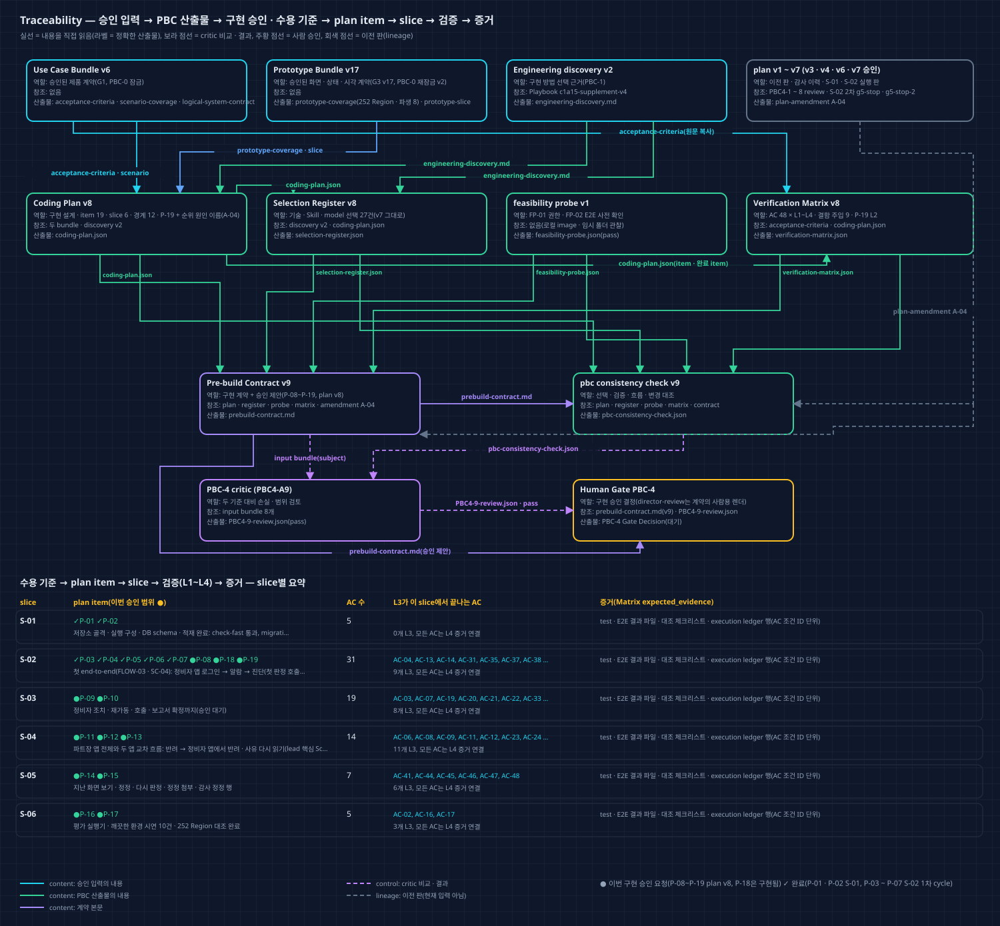
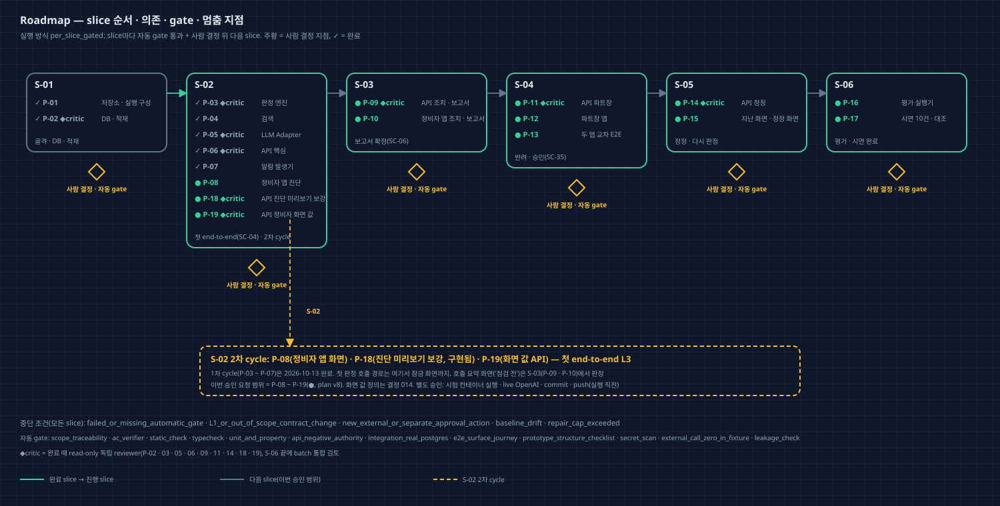

# Coding Plan v8 — Director Review

Run `2026-10-11-c1a15-product-r2` · PBC-4 · approval attempt `PBC4-A9`(L1 plan amendment A-04, 부모 PBC4-A8 pass · 승인, plan v7) · 독립 검토 pass(`critics/PBC4-9-review.json`) · 계약 `prebuild/v9/prebuild-contract.md` · 2026-10-13. 이 문서와 그림 4장은 critic pass 뒤 같은 plan v8에서 한 번 렌더했다(plan은 고치지 않음). 승인된 v7과 달라진 점: `coding-plan/amendments/A-04/plan-amendment.md`, 계기: `execution/S-02/cycle-2/g5-stop-2.md`. A-03(v6 → v7)은 `coding-plan/amendments/A-03/plan-amendment.md`.

## 한눈에 보기

- **왜 다시 계획했나:** P-19를 구현하기 전에 화면 template을 영역 단위로 다시 대조했다. 진단 화면 T04의 원인 후보 순위(R-RANK)에 원인 이름이 보여야 하는데 응답에는 원인 코드만 있었고, 이 영역을 맡은 API item이 없었다.
- **바뀐 것(v7 대비):** P-19에 T04 / default / R-RANK를 더했다. 세션 응답에 cause_names(원인 코드 → 매뉴얼 원인 표의 이름)를 넣는다. P-06의 % · 근거 n은 그대로다. Matrix AC-40 L2 문구 하나가 바뀌었다.
- **그대로인 것:** P-19 밖 item 18개, AC 48 · 경계 12 · slice · 기술 선택 · 결함 주입 9 · 실행 방식 · 금지 · 별도 승인 행동, 결정 014, v8 승인의 실행 해석.
- **이번 승인 범위:** **P-08 ~ P-19**(plan v8), 실행 방식 `per_slice_gated`. 다음은 S-02 2차 cycle을 이어 가는 것이다(P-19 → P-08).
- **검토 이력:** … A6 pass(v6, 승인), A7 pass(v7, 기록 실패), A8 pass(v7, 승인), **A9 pass(v8)**.

## 사용자 기대와 계획의 대응

| 사용자가 이 단계에서 기대한 것 | 계획 artifact / ID | 확인 방법 |
| --- | --- | --- |
| 화면은 서버가 준 값만 보인다 | P-19(응답에 화면 값), P-08(그 값만 그림) | P-19 API 통합 시험 · P-08 component 시험 |
| 평소 범위 = 1~9월 2.5~97.5 백분위(결정 014 ①) | P-19 ⑧ data normal_ranges | 재생성 diff는 normal_ranges · manifest hash뿐 |
| 최대 m · 근거 기록 · 오늘 교대(결정 014 ② ~ ④) | P-19 ①②⑥ | 표 기반 unit · 교대 경계 시각 시험 |
| AI 해석은 판정이 아닌 문장, 근거 검사(R8) | P-19 ③ ai_reading | 근거 없는 가짜 adapter에서 '원문으로 대체됨' |
| 잠금 전에는 1.2절만(R1) | P-19 ⑤ lock_instruction | 다른 절 원문 409(음성) |
| 완료 · 구현 item은 그대로 | P-01 ~ P-07 · P-18 계약 비교 | consistency check change_representation |
| 순위에 원인 이름(T04 R-RANK) | P-19 ⑨ cause_names | 표 기반 unit · AC-40 L2 |

## What remains fixed

승인 Use Case Bundle v6 · Prototype Bundle v17(`approved-inputs/approved-artifact-manifest.json` v2)의 AC · 흐름 · 권한 · 데이터 의미 · 화면 구조 · Component foundation · 표시 조정 · 생성자 해석 · T04 / first_call 규칙 예외(그 상태에서만)가 고정된다. 기준선은 `discovery/planning-baseline.json` v3(HEAD f73c240, S-01 · S-02 산출물은 commit 전)이다.

## What this plan will and will not do

- **한다:** 아래 plan item. ✓는 완료, ●는 이번 승인 요청이다.
- **하지 않는다:** 배포 · 외부 메시지 · 실제 설비 연동 · Non-goals. 앱이 화면 값을 직접 만들지 않는다. 완료 item 계약을 바꾸지 않는다. live OpenAI는 승인 전에 쓰지 않는다. 다른 저장소 · Wiki를 고치지 않는다.

| Item | 내용 | Slice | 상태 | 검토 | AC |
| --- | --- | --- | --- | --- | --- |
| P-01 | 저장소 · 실행 구성 | S-01 | ✓ 완료 | automatic | 2 |
| P-02 | DB · 적재 | S-01 | ✓ 완료 | independent_critic | 4 |
| P-03 | 판정 엔진 | S-02 | ✓ 완료 | independent_critic | 16 |
| P-04 | 검색 | S-02 | ✓ 완료 | automatic | 3 |
| P-05 | LLM Adapter | S-02 | ✓ 완료 | independent_critic | 3 |
| P-06 | API 핵심 | S-02 | ✓ 완료 | independent_critic | 10 |
| P-07 | 알람 발생기 | S-02 | ✓ 완료 | automatic | 3 |
| P-08 | 정비자 앱 진단(T04 / first_call 포함) | S-02 | ● 승인 요청 | automatic | 22 |
| P-18 | API 진단 미리보기 보강 | S-02 | ● 승인 요청(구현됨, G5 중단) | independent_critic | 3 |
| P-19 | API 정비자 화면 값(새, + 순위 원인 이름) | S-02 | ● 승인 요청 | independent_critic | 7 |
| P-09 | API 조치 · 보고서 · 호출 요약 | S-03 | ● 승인 요청 | independent_critic | 17 |
| P-10 | 정비자 앱 조치 · 보고서 · 호출 | S-03 | ● 승인 요청 | automatic | 17 |
| P-11 | API 파트장 | S-04 | ● 승인 요청 | independent_critic | 13 |
| P-12 | 파트장 앱 | S-04 | ● 승인 요청 | automatic | 12 |
| P-13 | 두 앱 교차 E2E | S-04 | ● 승인 요청 | automatic | 7 |
| P-14 | API 정정 | S-05 | ● 승인 요청 | independent_critic | 5 |
| P-15 | 지난 화면 · 정정 화면 | S-05 | ● 승인 요청 | automatic | 7 |
| P-16 | 평가 실행기 | S-06 | ● 승인 요청 | automatic | 3 |
| P-17 | 시연 10건 · 대조 | S-06 | ● 승인 요청 | automatic | 2 |

## Implementation design

경계 12개는 v6와 같다. P-19가 B-04(API) · B-05(판정 엔진) · B-07(LLM Adapter) · B-08(저장소)에 더해졌다.

## Why this engineering approach

v6와 같다. 새 기술 선택은 없다. P-19는 이미 선택한 FastAPI · OpenAPI 정본 · LLM Adapter(fixture) · R8 근거 검사 · 적재 자료 생성 스크립트를 그대로 쓴다. 새 엔드포인트 대신 기존 응답에 값을 더해 화면 하나가 응답 하나를 읽게 한다.

## Engineering, skills, and model roles

Selection Register v7: record 27건(채택 21 · 제외 6). v6와 결정 · 근거가 같고, P-19가 쓰는 record 7건의 plan_item_ids에 P-19만 더해졌다. Playbook `c1a15-supplement-v4` 그대로.

## Traceability map

- 실선은 내용을 직접 읽는 관계이고, 라벨은 정확한 산출물 이름이다. 보라 점선은 critic 비교 · 결과, 회색 점선은 이전 판이다.
- 아래 표는 slice별 item(✓ 완료 · ● 이번 승인 요청) · AC 수 · 그 slice에서 끝나는 L3 AC다. 모든 AC는 L4 증거 연결을 갖는다.
- orphan 산출물 · unknown 관계는 없다.

## Delivery roadmap

S-02 2차 cycle(P-19 → P-08, P-18은 구현됨)을 이어 간다. slice마다 자동 gate가 통과하고 사람이 결정한 뒤 다음으로 간다. ◆critic item은 완료 때 read-only 독립 reviewer가 검토한다.

## Risks, authority boundaries, and stop conditions

- **실행 방식:** `per_slice_gated`
- **이번 승인 요청 item:** P-08, P-09, P-10, P-11, P-12, P-13, P-14, P-15, P-16, P-17, P-18, P-19
- **중단 조건:** failed_or_missing_automatic_gate · L1_or_out_of_scope_contract_change · new_external_or_separate_approval_action · baseline_drift · repair_cap_exceeded
- **금지:** 승인 Use Case Bundle v6 · Prototype Bundle v17의 AC · 사용자 흐름 · 권한 의미 · 데이터 의미 · 화면 구조 · 시각 규칙 변경; T04 / first_call의 규칙 예외(R-NEXT의 C · D 점검 정보 · '점검 시작'의 호출 경고 토큰)를 그 상태 밖 화면 · 상태에 쓰기; 완료된 P-01 ~ P-07의 계약 바꾸기(바꿀 일이 생기면 L1 amendment); eval/cards · generation/cause_ratio_table.json을 진단 처리 · 색인 · 적재기에서 읽기; 비밀번호 · API 키 원문을 저장소 · 로그 · DB에 쓰기; fixture 시험 · 시연에서 외부 네트워크 호출; plan item 밖 파일 · 다른 저장소 수정, Wiki 쓰기; 배포 · 외부 메시지 전송
- **별도 승인(실행 직전):** live OpenAI 문장 · 임베딩 smoke(소수 · 격리, 키는 사용자 제공); live 모드 평가 실행; npm · uv 패키지 설치, Python 3.12 내려받기; Docker image pull(python · node 빌드 image 등 로컬에 없는 것); Playwright 브라우저 내려받기(1.63.0 밖의 판을 쓸 때); git commit · push; Docker 컨테이너로 시험 DB · 시험 스택 실행(첫 실행 전 한 번)

**v8 승인(PBC4-A8)의 실행 해석 — 그대로 이어 감:** ① PW 센서 표 = 알람 센서 + 4개 5행 ② data · OpenAPI hash 변경은 P-19 예상 변경으로 기록 ③ S-03 홈 값 채우기 확인은 S-03 packet에, 화면에 쓰지 않는 값은 응답에만.

**독립 검토(PBC4-A9)의 비차단 의견** — plan은 고칠 수 없다. 아래 실행 해석으로 승인 때 함께 정한다.

1. selected_approach에서 ⑨가 ⑧ 앞에 있다(번호 순서만).
2. T04의 원인 이름이 두 곳(R-RANK = 원인 표, R-RECORDS = 이력 기록 값)에서 나온다. 같은 코드면 같은 문자열인지 확인하면 좋다. 현재 데이터에서는 이력 기록 253건의 원인 이름이 모두 원인 표 14개 이름과 같다(확인함).
3. 상단 바 사용자 표시는 로그인 응답 값을 쓴다고 했는데 P-06 계약 문장에는 따로 적혀 있지 않다. 지금 로그인 응답은 user_id · display_name · role을 준다(`server/src/c1a15/api/main.py` login).

## 승인자에게 요청할 결정

1. **구현 승인:** 승인 / 수정 요청 / 보류 / 제품 변경 요청. 대상은 plan v8의 P-08 ~ P-19이고, 실행 방식 · 중단 조건 · 금지 · 별도 승인 행동은 위와 같다.
2. **실행 해석(비차단 의견 처리):** ① ⑨ · ⑧ 순서는 다음 plan 판에서 정리 ② P-19 시험에 '같은 원인 코드의 cause_names와 similar_cards 원인 이름이 같다'를 더함 ③ 상단 바 사용자 표시 = 로그인 응답의 display_name(기기에 둠) + P-19 shift의 교대 이름, S-02 2차 cycle 영역 대조표에 응답 필드로 적음.

## Approval effect

- 승인하면 plan v8의 P-08 ~ P-19을 slice마다 사람 결정을 거치며 구현할 수 있다. Gate Decision의 `implementation_authorization`은 이 문서의 proposal과 같은 값이어야 한다.
- 승인으로 허용되지 않는 것: live OpenAI 문장 · 임베딩 smoke(소수 · 격리, 키는 사용자 제공); live 모드 평가 실행; npm · uv 패키지 설치, Python 3.12 내려받기; Docker image pull(python · node 빌드 image 등 로컬에 없는 것); Playwright 브라우저 내려받기(1.63.0 밖의 판을 쓸 때); git commit · push; Docker 컨테이너로 시험 DB · 시험 스택 실행(첫 실행 전 한 번). 이 행동들은 각각 실행 직전에 따로 묻는다.
